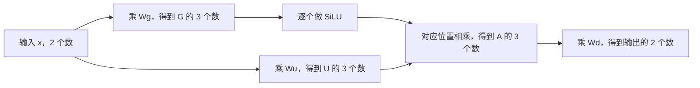
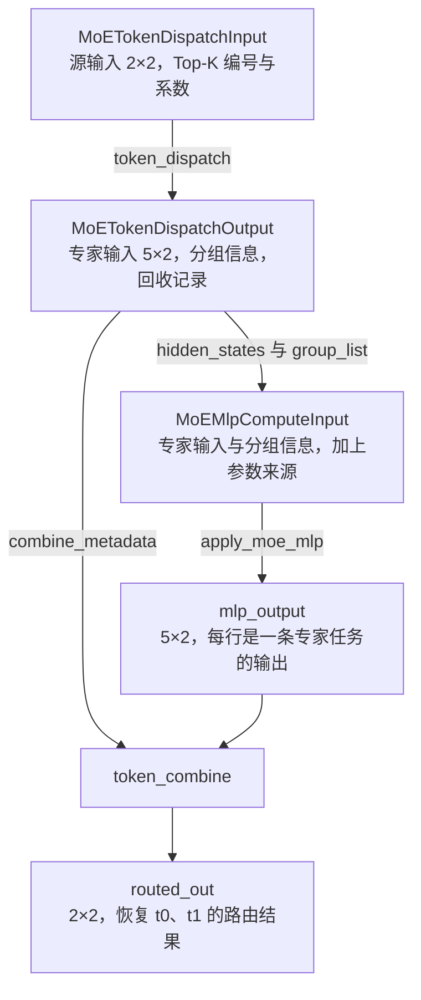

# MoE FFN 从具体计算到 vLLM-Ascend 多卡执行

本文以读懂模型前向代码为目标。从一行数字出发，先算清乘法与加权求和，再把它们组成 FFN，接着增加多套 FFN 和选择规则，引出“专家”与 MoE。每个主要计算随后对应到源码中的名称、字段、数组形状，以及产生和使用这些数据的调用。

配套的[本地互动示例](./MoE-FFN-互动示例.html)可以直接用浏览器打开，离线切换入口布局、下游布局和计算阶段，并查看每一步的向量通信量。它是包含页面结构、样式和交互程序的单个 HTML 文件。普通 Markdown 阅读器通常不会执行嵌入的 JavaScript，因此这里用链接打开配套 HTML。PDF 与普通 PPT 页面中的截图也不保留这段网页交互。

[第 1 章](#1-从一行数字建立-ffn-和-moe)建立计算过程并对照常见代码名，[第 2 章](#2-deepseek-v41-与-ling-30-flash)代入两模型的尺寸与实际 MLP/MoE 类，[第 3 章](#3-两张卡手算-dispatch-与-combine)手算两卡分发与回收，再由 §3.5 将同一批数放入真实数据对象，[第 4 章](#4-四种实现如何执行同一个-moe)比较四种实现，[第 5 章](#5-vllm-ascend-如何选择执行路径)对照框架的选择代码，[第 6 章](#6-沿实际对象读懂一次-moe-前向)给出从模型入口到设备算子的读码路线。实现部分固定到工作区 `vllm-ascend` 的 `fix_megamoe` 分支，提交 `e0bd9a4c2cc53585413e6e36b19d1369d7158d6c`。

## 1. 从一行数字建立 FFN 和 MoE

### 1.1 进入这一层的数据是什么

语言模型先把文本切成一个个处理单元，每个单元称为 **token**。一个 token 可以对应一个字、一个词或词的一部分，具体由模型配套的切分规则决定。程序用整数编号表示词表中的这种单元，称为 **token ID**。同一个 token 重复出现时，可以有相同 token ID，但处在不同输入行。后面的 t0、t1 表示本批里的行身份，搬运之后恢复输出需要保留这种行身份。

在模型内部，每个 token 又用一串数字表示。不同层会不断更新这串数字。进入本文讨论的 FFN 时，假设一个 token 的当前表示只有两个数。

```text
第一个 token 的当前表示    [1, 2]
第二个 token 的当前表示    [3, 4]
```

这些是为手算编造的数。真实模型的一串数字往往有几千个。第一个 token 的编号可能是 17，但它进入这一层时的表示是 `[1,2]`。词表编号说明它是哪种 token，当前表示向量用于参与计算。

一串数叫 **向量**。把多行向量放在一起，得到一个 **矩阵**。上面两行写成

$$
X=\begin{bmatrix}1&2\\3&4\end{bmatrix}.
$$

这里一行对应一个 token，一列对应其表示中的一个数。这个矩阵有 2 行、2 列，程序把它的 **形状（shape）**写成 `[2,2]`。形状只说明各方向有多少个数。当前表示的长度叫 **hidden size**，本例为 2。代码中的 `hidden_states` 通常指这批 token 的当前表示。程序把一维、二维或更多维的数值数组统称为 **张量（tensor）**，矩阵就是这里的二维张量。

计算产生的这些输入和中间数值，在实现文章里统称为 **激活（activation）**。这个词也会出现在“激活函数”中，后面会解释两种用法。

**代码对照：输入编号、输入表示与临时变量**

读代码时，先区分 `input_ids` 和 `hidden_states`。前者保存 token 在词表中的整数编号，例如 `[17,205,8]`；框架用这些编号查询 embedding（词嵌入表，每个编号对应一行向量），得到每个 token 的一行浮点数。后者保存这类向量以及后续各层更新后的向量，才是后面矩阵乘的输入。FFN 入口的 `hidden_states` 可对应数学 $X$，通常已经经过前面多步计算。

`activation` 常指本次输入或计算产生的数值数组。`x` 也是常见的临时变量名，需要看当前位置的赋值才能判断它代表什么。它们与从 checkpoint 加载、供不同请求反复使用的模型参数有不同角色。[Ling 查询 embedding 的代码](/Users/jwx02384838/Projects/github/theta/vllm/vllm/model_executor/models/bailing_moe_v3.py:1346)

### 1.2 一次线性层计算，就是用固定系数求新的数

先只看第一行 `[1,2]`。我们想用它算出三个新数，规定三套系数。

| 要算的数 | 具体计算 | 结果 |
| --- | --- | --- |
| 第 1 个输出 | $1\times1+2\times0$ | 1 |
| 第 2 个输出 | $1\times0+2\times1$ | 2 |
| 第 3 个输出 | $1\times2+2\times(-1)$ | 0 |

每个输出都是输入各个数乘一个系数，再相加。这叫 **加权求和**。把上面三套系数排成矩阵，就能把三行计算写在一起。

$$
x=\begin{bmatrix}1&2\end{bmatrix},\quad
W=\begin{bmatrix}1&0&2\\0&1&-1\end{bmatrix},\quad
xW=\begin{bmatrix}1&2&0\end{bmatrix}.
$$

符号 $xW$ 表示矩阵乘法。$W$ 的每一列装着“算出一个输出所需的系数”，依次取各列和输入相乘相加，就得到输出的三个数。输入有 2 个数，因此 $W$ 每列需要 2 个系数。输出要有 3 个数，因此 $W$ 需要 3 列。尺寸关系为 `[1,2] × [2,3] → [1,3]`。

第二行 `[3,4]` 使用同样的 $W$，输出为 `[3,4,2]`。多行一起算就是

$$
\begin{bmatrix}1&2\\3&4\end{bmatrix}
\begin{bmatrix}1&0&2\\0&1&-1\end{bmatrix}
=
\begin{bmatrix}1&2&0\\3&4&2\end{bmatrix}.
$$

输出仍然是一行对应一个 token，每行从 2 个数变成 3 个数。神经网络把这种可学习系数的计算组织成一个 **线性层（Linear）**，$W$ 中的数叫 **模型权重**。用样本反复计算并调整这些数的过程叫训练。加载调整好的数，对新输入计算结果的过程叫推理。模型中通过训练调整的数统称为参数，权重矩阵中的数是其中一类。

线性层还可以在每个输出上加一个固定的、同样可学习的偏移。例如再加 `[0.5,-0.5,1]`，第一行输出就从 `[1,2,0]` 变成 `[1.5,1.5,1]`。这个偏移叫 **bias（偏置）**，它也是模型参数。后面的手算先把偏置取为 0。

再把这个过程与 PyTorch 的字段名对上。

| 字段或说法 | 在本例中的含义 |
| --- | --- |
| `in_features=2` | 每行输入有 2 个数 |
| `out_features=3` | 每行输出有 3 个数 |
| feature | 在这个尺寸说明中，指向量中的一个位置 |
| 参数个数 | 矩阵有 $2\times3=6$ 个可学习的数，若启用偏置再加 3 个 |

这两个 `features` 数描述每行的宽度。一次处理多少个 token，决定的是行数。

有一个容易在读代码时卡住的存储约定。本文按“输入行向量右乘 $W$”写公式，因此上面的 $W$ 是 2 行、3 列。PyTorch 的 `Linear(2,3,bias=False)` 把同样的系数保存为 3 行、2 列，每行存一套输出系数。

```text
本文公式中的 W           PyTorch 的 layer.weight
[1, 0,  2]               [1,  0]
[0, 1, -1]               [0,  1]
                         [2, -1]
```

把行列互换叫 **转置**，记作上标 $\top$ 或代码中的 `.T`。PyTorch 前向算 `x @ layer.weight.T`，仍然得到 `[1,2,0]`。这是同一组系数在公式与程序中的排列对应，设备怎样读取它们由具体算子实现处理。所以看到 `[out_features,in_features]`，可以把它读成“每个输出各存一行输入系数”。[PyTorch Linear 文档](https://docs.pytorch.org/docs/stable/generated/torch.nn.Linear.html)

### 1.3 模型权重怎样保存，checkpoint 又指什么

刚才的 $W$ 是一个线性层的一张参数表。真实模型有很多层，每层可能有好几张这样的表。**模型结构**规定按什么顺序做哪些运算，各张表需要多少行、多少列。**模型权重**给出这些表中训练得到的具体数值。

训练进行到某个时刻，可以把模型状态保存下来，之后从这里继续训练，或者拿它做推理。这份保存的状态称为 **checkpoint（检查点）**。保存时可以只存模型参数，也可以同时存训练进行到第几步、下一步更新参数所需的训练记录等。训练结束后发布的版本也常被称为 checkpoint。[PyTorch 保存与加载说明](https://docs.pytorch.org/tutorials/beginner/saving_loading_models.html)

实际下载一个发布模型时，经常看到下面这样的目录。这里的文件名只是示意。

```text
模型发布目录/
  config.json
  model-00001-of-00008.safetensors
  model-00002-of-00008.safetensors
  ...
  model-00008-of-00008.safetensors
  model.safetensors.index.json
  tokenizer.json
```

`config.json` 说明层数、每层尺寸等配置。`.safetensors` 是保存参数数组的一种文件格式。模型太大时，参数分在多个文件中，索引文件记录每个具名参数保存在哪个文件。这里的 8 个文件共同存放这套参数。`tokenizer.json` 等配套文件记录文本与 token 编号的转换规则。框架结合模型代码和配置建立计算结构，再把参数放到对应位置。

因此，“加载这个 checkpoint”在部署语境中，通常指加载某个已保存模型版本及其参数。某个文件可能只保存其中一部分参数，保存者也可以专门保存一个模块，但 checkpoint 这个词本身表示保存下来的状态，不能据此推断它对应哪几层。

把刚才的例子对应起来，`layer.weight` 里的数可以从 checkpoint 加载。`[1,2]` 和算出的 `[1,2,0]` 则来自本次输入。换一个请求，后两者会变化，而同一次推理服务通常复用相同的模型参数。

### 1.4 在求和之后，对每个数再做一次变换

如果一直只做矩阵乘法，例如先乘 $W_1$ 再乘 $W_2$，这两步可以合成一次乘以 $W_1W_2$。为了让多层计算能表达更复杂的关系，神经网络在中间加入非线性变换。

先看最容易手算的规则，负数变成 0，非负数保留。`[1,-2,3]` 因而变成 `[1,0,3]`。这个规则叫 **ReLU 激活函数**。函数就是输入一个数、按规则得到输出的计算。这里对向量中的每个数分别应用同一条规则。

本文两个模型会用到另一条规则，先把一个数 $g$ 变成 $\sigma(g)=1/(1+e^{-g})$，再乘回原数 $g$。$e\approx2.71828$ 是指数运算的底数，$e^{-g}$ 表示相应的指数值。第一步叫 **sigmoid**，第二步整体叫 **SiLU**。

$$
\operatorname{SiLU}(g)=g\,\sigma(g).
$$

| 输入 $g$ | sigmoid 的输出 | SiLU 的输出 |
| --- | ---: | ---: |
| 1 | 约 0.7311 | 约 0.7311 |
| 2 | 约 0.8808 | 约 1.7616 |
| -1 | 约 0.2689 | 约 -0.2689 |

后面手算遇到 `SiLU(1)`，直接用 0.7311 即可。激活函数描述的是如何改变数值，§1.1 的“激活”描述的是输入或计算中间产生的数值数组。

### 1.5 把几步运算接起来，得到一个 FFN

现在可以把计算接成一小段网络。先用一张矩阵把每行 2 个数变成 3 个数，对这 3 个数分别做激活函数，再用另一张矩阵变回 2 个数。

```text
输入一行            第一次线性计算       激活函数         第二次线性计算
[1,2]       →       [1,2,0]       →     [1,2,0]    →     [3,1]
```

这里第一次计算沿用 §1.2 的 $W$，激活函数取 ReLU，第二张权重取 $\begin{bmatrix}1&1\\1&0\\0&1\end{bmatrix}$。最后两个输出就是 $1+2+0=3$ 和 $1+0+0=1$。输入和输出各有 2 个数，中间有 3 个数。

这种输入沿运算方向逐步得到输出的网络叫 **前馈神经网络（Feed-Forward Network，FFN）**。大模型里常把其中处理每个 token 表示的这一段称为“FFN 子层”。它也常被叫作 **MLP**，全称是 Multilayer Perceptron，中文为多层感知机。后面阅读 MoE 实现时，“专家 MLP”指的就是对应的这段 FFN 计算。

这个名称对应还直接体现在参数加载代码中。本地 DeepSeek 加载器会将权重路径中的 `.ffn.` 转成模型对象使用的 `.mlp.`。

```python
if ".ffn." in name:
    name = name.replace(".ffn.", ".mlp.")
```

因此，读到 `self.mlp` 时，应先把它识别为这一层的 FFN 位置。里面可以放不同的 FFN 结构，§1.7 起会逐步引入多套 FFN 的选择与组合，§2.3 再对应两模型的实际类名。[FFN 路径到 MLP 路径的实际转换](/Users/jwx02384838/Projects/github/theta/vllm-ascend/vllm_ascend/models/deepseek_v41/model.py:1861)

一次线性计算加一个激活函数，是构建网络时常用的一段计算。FFN 可以包含多个这样的步骤。本文此处讨论的 Transformer FFN，完整范围包括上面两次线性计算和中间的激活函数。

通常把每个 token 在这整个 FFN 入口、出口的向量长度记为 $H$，中间向量长度记为 $I$。本例 $H=2,I=3$。给内部步骤命名时，第一次线性计算把向量从 $H$ 个数变为 $I$ 个数，称为 **上投影（up projection）**。随后做激活函数，再由第二次线性计算把向量从 $I$ 个数变为 $H$ 个数，称为 **下投影（down projection）**。因此上投影和下投影都是这一段 FFN 的内部组成部分。

```text
                    本例整个 FFN 的计算范围
      ┌──────────────────────────────────────────┐
输入  │ 上投影（线性） → 激活函数 → 下投影（线性） │  输出
2个数 │     2 → 3         3 → 3         3 → 2     │  2个数
      └──────────────────────────────────────────┘
```

许多 FFN 选择 $I>H$，因此上面的两个名称也对应先增加长度、再恢复长度。这里“恢复”指输出重新有 $H$ 个数，输出数值由网络算出一套新表示。例如本例输入是 `[1,2]`，输出是 `[3,1]`。“投影”在这类模型代码中表示用权重矩阵计算新表示，具体输入输出长度由矩阵尺寸决定。

FFN 对每行应用相同的一套参数。一次把多行放进矩阵乘，只是把相同规则同时应用到很多个 token。大模型的注意力子层（Attention）负责让一个 token 汇入其他位置的信息，接着 FFN 再处理更新后的各行表示。模型会重复这样的层。

### 1.6 增加两条中间计算分支，得到本文需要的 SwiGLU FFN

继续改刚才的小网络。让同一行输入分别乘两张矩阵，得到两个长度相同的中间向量。对第一个向量做 SiLU，再与第二个向量按位置相乘，最后乘一张矩阵恢复输出长度。

输入仍取 $x=[1,2]$，中间长度仍取 3，明确写出三张参数表。

$$
W_g=\begin{bmatrix}1&0&-1\\0&1&0\end{bmatrix},\quad
W_u=\begin{bmatrix}1&1&0\\0&0&1\end{bmatrix},\quad
W_d=\begin{bmatrix}1&0\\0&1\\1&1\end{bmatrix}.
$$

第一步，两张矩阵分别计算。

$$
G=xW_g=[1,2,-1],\qquad U=xW_u=[1,1,2].
$$

第二步，先变换 $G$ 的每个数，再与 $U$ 的对应位置相乘。

$$
\begin{aligned}
\operatorname{SiLU}(G)&\approx[0.7311,1.7616,-0.2689],\\
A=\operatorname{SiLU}(G)\odot U&\approx[0.7311,1.7616,-0.5379].
\end{aligned}
$$

$\odot$ 是**逐元素乘法**，即第一个数乘第一个数、第二个乘第二个，以此类推。这一步仍有 3 个数。它和 §1.2 的矩阵乘法使用不同的规则。

第三步，乘 $W_d$，恢复成 2 个数。

$$
Y=AW_d=[A_1+A_3,A_2+A_3]\approx[0.1932,1.2237].
$$

这里 $A_1,A_2,A_3$ 分别指 $A$ 的第 1、2、3 个数。现在再给这些已经算过的东西命名。$G$ 经过 SiLU 后逐个调节 $U$ 中的数，这条分支叫 **gate（门控）分支**，对应 $W_g$。$U$ 这条分支通常叫 **up 分支**，对应 $W_u$。最后恢复输出长度的是 **down 分支**，对应 $W_d$。把这种门控组合称为 **SwiGLU**，名称中的 Swi 来自 Swish，本例使用它常用的 SiLU 形式，GLU 来自 Gated Linear Unit（门控线性单元）。[GLU 变体论文](https://arxiv.org/abs/2002.05202)



完整的 SwiGLU FFN 由这三张参数表和中间规则共同定义。激活函数 SiLU、逐元素乘法都用刚才的规则计算，这里没有额外的可学习参数。代码中的 `gate_proj`、`up_proj`、`down_proj`，分别指实现这三次矩阵乘的线性层。

**代码对照：一个 MLP 的 forward 怎样完成这些步骤**

先看 Ling 的普通 FFN 实际怎样写。下面的 `forward` 是拿输入算输出的方法，`self` 表示当前模块对象，`self.gate_up_proj` 则是它里面的一部分。省去初始化后，计算只有下面几行。

```python
def forward(self, x):
    x, _ = self.gate_up_proj(x)
    x = self.act_fn(x)
    x, _ = self.down_proj(x)
    return x
```

第一行同时计算刚才的两条分支，输出按最后一维拼接的 `[G,U]`。因此代码只调用一次 `gate_up_proj`，数学上仍有两套独立参数、两次投影的结果。`act_fn` 从拼接结果取出两半，完成激活与逐元素乘法。`down_proj` 再恢复长度。把一次输入的 token 行数记作 T，以每套参数矩阵都完整保存的普通 FFN 为例，`x` 的形状依次是 `[T,H] → [T,2I] → [T,I] → [T,H]`。代码不断给 `x` 重新赋值，后面的 `x` 已经代表刚算出的中间结果。[Ling MLP](/Users/jwx02384838/Projects/github/theta/vllm/vllm/model_executor/models/bailing_moe_v3.py:420)

`SiluAndMul` 的名字把两步都写出来了，它计算 `SiLU(G) * U`。普通 SiLU 逐个改变数值，输入输出长度相同；这个组合操作则把两条长度为 $I$ 的分支变成一条，最后一维从 $2I$ 变为 $I$。普通 Ascend 路径中的 `npu_swiglu` 也承担这个组合。带 limit 的变体还会按模型规则限制数值。[SiluAndMul 的直接实现](/Users/jwx02384838/Projects/github/theta/vllm/vllm/model_executor/layers/activation.py:138)、[Ascend 调用 npu_swiglu](/Users/jwx02384838/Projects/github/theta/vllm-ascend/vllm_ascend/ops/fused_moe/moe_mlp.py:97)

`x, _ = ...` 是拆开函数返回的两个对象。这里 `_` 接收线性层包装器返回的偏置信息，常为 `None`；两条 SwiGLU 分支已经合在第一个返回张量里。[线性层的返回约定](/Users/jwx02384838/Projects/github/theta/vllm/vllm/model_executor/layers/linear.py:599)

### 1.7 从多套独立 FFN 和选择规则，引出“专家”

刚才只有一套 $W_g,W_u,W_d$，每个 token 都用这套参数。现在准备四套相同计算形式、各自有独立参数的 FFN，暂称为 FFN0、FFN1、FFN2、FFN3。每套输入和输出的长度相同，中间长度可以比原来那套大型 FFN 小。

如果一个 token 只用其中两套，例如把同一输入 $x$ 分别交给 FFN0 和 FFN2，得到 $y_0$、$y_2$，再按 $3/4$ 和 $1/4$ 合起来，就有

$$
y=\frac34y_0+\frac14y_2.
$$

这里的相加也逐个位置进行。例如 $y_0=[2,0]$、$y_2=[0,4]$ 时，结果是 `[1.5,1]`。别的 token 可以选择另外两套 FFN，也可以使用不同的系数。

还需要一小段计算，根据当前输入决定选择哪几套、用什么系数。把这段选择计算叫 **Router（路由器）**。多套独立 FFN 在训练中可能对不同输入形成不同的处理倾向，MoE 文献把这些参与选择的子网络称为 **expert（专家）**。因此，本文后面出现 E0、E1、E2、E3，分别指刚才的四套 FFN 及其参数。其擅长的输入由训练形成，也可能是人难以直接命名的模式。

先看刚才这个具体方案，一共准备 4 套 FFN，一个 token 执行其中 2 套，再组合这 2 套输出。它属于 **sparse MoE（稀疏混合专家）**。也可以让一个 token 把 4 套全部执行完，再用 Router 算出的 4 个系数混合输出，这属于 **dense MoE（稠密混合专家）**。把“多套子网络加一套输出混合规则”统称为 **Mixture of Experts（MoE，混合专家）**，这里的混合系数通常由 Router 根据输入计算。MoE 可以采用上述不同的执行方式。[MoE 论文中的非稀疏与 Top-K 门控](https://arxiv.org/html/1701.06538v1#S2.SS1)

再与前面只有一套 FFN 的计算放到一起看。

| 结构 | 准备哪些 FFN 参数 | 一个 token 实际执行什么 |
| --- | --- | --- |
| dense FFN，稠密 FFN | 一套共同使用的 FFN 参数 | 每个 token 都执行这套完整 FFN，得到输出 |
| dense MoE，稠密 MoE | 多套独立 FFN，例如 4 套，外加 Router 参数 | 4 套全部执行，再按混合系数组合 4 份输出 |
| sparse MoE，稀疏 MoE | 多套独立 FFN，例如 4 套，外加 Router 参数 | 例如选 2 套，只执行这 2 套，再组合它们的输出 |

给 4 套 FFN 排好编号后，稠密 MoE 的某次系数可以是 `[0.4,0.3,0.2,0.1]`，4 套都需要计算。稀疏 MoE 的某次系数可以是 `[0.7,0,0.3,0]`，实际只需计算 FFN0、FFN2。这里“稀疏”描述的是**每个 token 的专家参与情况**，对应系数向量只有少数位置非零。

对 dense FFN，可以把唯一的一套共同 FFN 形象地理解成“所有 token 都经过的一个大专家”。它按固定的一套 FFN 参数计算。dense MoE 则显式保留多个独立 FFN，以及随输入决定如何混合输出的 Router。因此，将两者判断为数学等价还需要检查具体参数结构和混合规则。

在现代大模型的讨论中，经常将稀疏 MoE 简称为 MoE。本文后续讨论的 DeepSeek、Ling 以及分发回收实现，都采用每 token 选择少数路由专家的稀疏方案。把这种结构放到原来单套 FFN 的位置，就得到本文讨论的 MoE FFN。

还可以增加一套无须选择、所有 token 都会执行的 FFN，把它的输出直接加到前面结果上。因为所有 token 都使用它，这套网络叫 **shared expert（共享专家）**。前面那些按 token 选择的网络叫 **routed experts（路由专家）**。共享专家也有自己的模型参数。

### 1.7.1 专家全部计算，为什么还会有实际用途

先固定比较条件。如果每套 FFN 尺寸相同，4 套全部计算的矩阵乘工作量，大约是只执行其中 2 套的两倍。这个条件下，稀疏执行确实可以减少计算。实际设计还会同时决定每个专家有多大，以及希望模型同时完成哪些任务。

例如一个网络需要同时预测“会不会点击”和“会不会点赞”。强行让两个任务使用同一份中间表示，可能不适合它们各自的目标。可以准备 4 套 FFN，先对同一条输入全部算一次，得到 4 份表示，再让每项任务用自己的 Router 决定如何组合。

| 演示任务 | 4 个专家的混合系数 |
| --- | --- |
| 点击预测 | `[0.7,0.1,0.1,0.1]` |
| 点赞预测 | `[0.1,0.1,0.1,0.7]` |

这些系数只是演示。两个任务复用已经算好的 4 份专家输出，分别得到适合自身的混合表示，再各接一段小网络产生最终预测。训练可以让不同 FFN 学到不同处理倾向，也让任务学会怎样复用它们。同一组专家提供了可调整的任务间共享方式。

实际例子是 Google 的 **MMoE（Multi-gate Mixture-of-Experts，多门控混合专家）**，它为不同任务准备各自的 Router。这里名字中的 gate 指控制混合系数的路由器。Google 在 2018 年介绍这个模型，并在 2019 年发表的 YouTube 多目标排序系统中使用它，研究观看投入与满意度等目标。[MMoE 论文介绍](https://research.google/pubs/modeling-task-relationships-in-multi-task-learning-with-multi-gate-mixture-of-experts/) · [YouTube 排序系统论文介绍](https://research.google/pubs/recommending-what-video-to-watch-next-a-multitask-ranking-system/)

还有一项容易忽略的尺寸条件。4 套较小 FFN 的总矩阵乘量，可以与一套较宽 FFN 接近。例如在相同输入输出长度下，将单套 FFN 的中间长度设为 $4I$，它的三张矩阵共有约 $12HI$ 个参数，主矩阵乘约 $24HI$ FLOPs。4 套中间长度为 $I$ 的 SwiGLU FFN 全部计算，主矩阵乘也约 $24HI$ FLOPs，另外再加 Router 和组合输出的工作。这是按 §1.10 相同计算形式推导的比较例子，具体系统仍需计入完整开销。

YouTube 2019 年论文也做了匹配计算规模的实际比较。表 1 中，共用单套底层网络的基线与 4 专家 MMoE 都约需 370 万次乘法，MMoE 改善了线上观看投入和满意度指标。这里的数字是论文统计的乘法次数。该模型使用 ReLU 网络，具体 FFN 形式与本文的 SwiGLU 示例有所不同。它说明多套较小网络加上混合规则，可以在相同预算下带来建模收益。[原论文 §4.3、§5.2、表 1](https://daiwk.github.io/assets/youtube-multitask.pdf)

### 1.8 Router 怎样算选择与混合系数

仍用四套 FFN 的例子。先让输入 $x$ 乘 Router 自己的一张权重矩阵 $W_r$，得到四个数，每个数对应一套 FFN。为了演示后续步骤，假设这次四个结果为 `[2,1,0,-1]`。

这四个原始打分叫 **logits**。$W_r$ 从模型参数加载，四个 logits 则根据本次输入现场计算。接下来可以用不同规则把 logits 变成便于比较的非负分数，常见规则如下。

| 规则 | 具体做法 |
| --- | --- |
| sigmoid | 对每个打分分别用 §1.4 的 sigmoid。每项在 0 到 1 之间，各项之和由输入决定。 |
| softmax | 先对每个打分 $z$ 求 $e^z$，然后每项除以这行所有 $e^z$ 的总和。这样所有项为正，且这一行的和为 1。 |
| sqrtsoftplus | 先算 $\operatorname{softplus}(z)=\log(1+e^z)$，再开平方。$\log$ 是自然对数，与以 $e$ 为底的指数运算互为逆运算，例如 $\log(e^2)=2$。这是后面 DeepSeek 模型使用的分数规则。 |

以 softmax 为例，`[2,1,0,-1]` 先变成约 `[7.389,2.718,1,0.368]`，除以总和 11.475 后约为 `[0.644,0.237,0.087,0.032]`。

如果每次选两套 FFN，就把分数最大的两项选出来。**Top-K** 表示“取最大的 K 项”，本例 $K=2$，选中 FFN0 和 FFN1。接着，把选中分数分别除以这两项之和，得到约 `[0.731,0.269]`。这种“除以总和，让它们的和变成 1”的处理叫 **归一化**。最终结果为 $0.731\,y_0+0.269\,y_1$。

实现把选中编号保存在 `topk_ids`，把组合输出用的系数保存在 `topk_weights`。后面本文将后一组数称为 **路由系数**，以便和 $W_g,W_u,W_d,W_r$ 这些模型权重区分。路由系数会随当前 token 改变。

实际模型还可能做两种调整。第一种是用“原分数加修正值”决定排名，例如原分数 `[0.6,0.5,0.1,0.05]`，修正值 `[0,0.2,0,0]`，排名就先看 `[0.6,0.7,0.1,0.05]`。这组修正值叫 **correction bias**。模型可以规定最终混合时仍取修正前的分数。第二种是在归一化之后把所有系数乘一个模型设定的倍率，比如乘 1.5，系数和就变成 1.5。第 2 章会按各模型的实际规则展开。

如果一行选了两个专家，这个 token 就有两次待执行的 FFN 计算，称为两条 **路由记录**。每条记录需要知道 token、选中专家，以及它是该 token 的第几个选择。对同一条记录，先算完 FFN 输出再乘路由系数。例如先乘输入再做 SiLU，通常会得到另一组结果，因为 SiLU 是非线性函数。

**代码对照：两种 gate，以及原始打分与路由系数**

对同一个输入 token，MoE 模块中的 `self.gate(hidden_states)` 可以产生“给各专家评分”的一行数；专家内部的 `gate_proj` 则产生 SwiGLU 中间分支的一行数。前者每列对应一个候选专家，后者每列对应这个 FFN 的一个中间特征。

这里 T 表示本次输入行数，E 表示候选专家总数，K 表示每行选中数量。

| 代码位置 | 输出的含义 | 常见输出形状 |
| --- | --- | --- |
| MoE 模块的 `self.gate` | 路由打分，随后选专家 | `[T,E]` |
| FFN 内的 `gate_proj` | 专家内部的 $G$ 分支 | `[T,I]` |
| 路由后的 `topk_ids` | 每个 token 选中哪些专家的整数编号 | `[T,K]` |
| 路由后的 `topk_weights` | 对应每条分支的浮点加权系数 | `[T,K]` |

`weight` 通常指长期保存的模型参数。路由系数虽然也带 `weights` 一词，却是本批输入经过路由现算出的数。变量名帮助定位，最终应沿赋值和形状确认含义。某些融合路径把路由移进执行器，参数名甚至沿用 `router_logits` 来传路由输入，仍须看生产它的分支。[Ling 的路由层](/Users/jwx02384838/Projects/github/theta/vllm/vllm/model_executor/models/bailing_moe_v3.py:1144)、[Ling 的路由前向](/Users/jwx02384838/Projects/github/theta/vllm/vllm/model_executor/models/bailing_moe_v3.py:1196)、[DeepSeek 的内部/外部路由分支](/Users/jwx02384838/Projects/github/theta/vllm-ascend/vllm_ascend/models/deepseek_v41/model.py:282)

### 1.8.1 归一化后为什么还要乘一个倍率

先分开看两个问题。归一化决定各专家输出按什么比例混合，额外倍率决定混合后的整份路由输出有多大。为便于手算，先用两个选中专家，原始分数分别为 3 和 1。

| 步骤 | 第一个专家的系数 | 第二个专家的系数 | 系数和 |
| --- | ---: | ---: | ---: |
| 原始分数 | 3 | 1 | 4 |
| 各自除以总和 4 | 0.75 | 0.25 | 1 |
| 再各自乘 1.5 | 1.125 | 0.375 | 1.5 |

两个专家之间的相对比例始终是 3 比 1。令它们算出的输出分别为 $y_0,y_1$，则最后得到

$$
1.125y_0+0.375y_1=1.5(0.75y_0+0.25y_1).
$$

例如 $y_0=[2,0]$、$y_1=[0,4]$，归一化系数先混成 `[1.5,1]`，乘倍率后变成 `[2.25,1.5]`。对于 DeepSeek 选中的 6 个专家，做法相同。乘倍率后的系数是输出计算用的系数，其总和由模型设定的倍率决定。

把归一化混合得到的路由分支输出记作 $R$，共享 FFN 输出记作 $S$，本文 DeepSeek 示例的 MoE 输出就是 $Y=1.5R+S$。由此可见，这个常数调节路由分支在相加时的数值幅度，专家之间的相对比例仍由 Router 决定。代码把它叫 `routed_scaling_factor`，可以乘在路由系数上，也可以在路由输出合成后统一乘一次。[归一化与倍率代码](/Users/jwx02384838/Projects/github/theta/vllm-ascend/vllm_ascend/ops/fused_moe/router/fused_topk_router.py:69) · [路由与共享分支合并](/Users/jwx02384838/Projects/github/theta/vllm-ascend/vllm_ascend/models/deepseek_v41/model.py:300)

为什么需要单独设置输出幅度？不同专家的输出经过加权混合，会形成自己的数值量级，归一化只能保证系数和为 1。设计者可以用额外倍率显式控制这份结果的整体大小。一个有公开说明的实际例子是 Moonshot 的 Moonlight 模型，论文明确将倍率设为 2.446，以使 MoE 输出的整体量级接近对照的 dense 模型。文中用 RMS（均方根）衡量一组输出数值的整体大小。[Moonlight 论文附录 C 的 Gate Scaling Factor](https://arxiv.org/html/2502.16982v1#A3)

对于 DeepSeek-V4.1-Flash，发布配置中的倍率为 1.5。我核对的公开报告和实现能确认它的计算作用，尚未找到解释为什么恰好选择 1.5 的实验或推导。这里应把“调节输出幅度”这一确定作用，与该具体数值的选择依据区分开。推理按发布配置执行，才能保留这一模型定义的计算。

### 1.9 许多 token 一起执行时，为什么会出现 GMM

假设三行输入分别选择以下两套 FFN。

| token | 选中的 FFN |
| --- | --- |
| t0 | FFN0、FFN2 |
| t1 | FFN1、FFN0 |
| t2 | FFN2、FFN1 |

一共是 6 条路由记录。此处先把所有参数和输入放在一张卡上理解，在卡内按需要使用的参数排列，就得到三个组。同一行输入被两个专家使用时，逻辑上建立两条计算任务。算子可以让这些任务引用同一行，也可以在重排缓冲区中保存重复行，具体取决于实现。

```text
FFN0 的输入组    [t0 的向量, t1 的向量]    配 FFN0 自己的权重
FFN1 的输入组    [t1 的向量, t2 的向量]    配 FFN1 自己的权重
FFN2 的输入组    [t0 的向量, t2 的向量]    配 FFN2 自己的权重
```

每组先做同样形式的矩阵乘，但不同组用不同的权重。把这些组的矩阵乘作为一个任务交给设备，叫 **Grouped Matrix Multiplication（分组矩阵乘，GMM）**。每组的输入行数可以不同，某个专家也可能没有输入。这是执行多套矩阵乘的组织方式。

再回到 SwiGLU FFN 的两条上投影分支。$xW_g$ 和 $xW_u$ 都是同一个输入分别乘一张矩阵，因此可以把两张权重按列并排，记为 $[W_g\mid W_u]$。乘一次后得到 `[G 的全部数, U 的全部数]`。本章 $I=3$，因此先得到 6 个数，按前后两半拆回两个 3 维向量，再做 SiLU 与逐元素乘法。这个合并后的第一段计算叫 `gate_up`。

MoE 实现把各组的 `gate_up` 矩阵乘称为 **GMM1**，把各组的 `down` 矩阵乘称为 **GMM2**。完整计算因而写作 `GMM1 → SiLU 与逐元素乘法 → GMM2`。

为了让设备认出每组有哪些行，程序可以把各组放在一段连续存储区里，再记录每组行数。沿用本节的三个非空组，各有 2 行，计数就是 `[2,2,2]`，逐项累计的结束位置是 `[2,4,6]`，叫 **前缀和**。它说明第一组到第 2 行结束、第二组到第 4 行结束、第三组到第 6 行结束。FFN3 这次没有收到输入，若把它也列在表尾，对应计数为 0，累积结束位置仍为 6。第 3 章会把这个排列过程与卡间传输合起来手算。

**代码对照：权重名字、专家维度与加载后的排列**

| 手算对象 | 单个 FFN 的常见名称 | DeepSeek 参考权重名称 | 合并后的执行名称 |
| --- | --- | --- | --- |
| $W_g$，产生 $G$ | `gate_proj` | `w1` | `gate_up_proj` / `w13_weight` 的 gate 部分 |
| $W_u$，产生 $U$ | `up_proj` | `w3` | 同一合并权重的 up 部分 |
| $W_d$，恢复 $H$ | `down_proj` | `w2` | `down_proj` / `w2_weight` |

`13` 表示把上述 `w1` 与 `w3` 收进同一存储和计算入口。加载时，框架按照参数映射把两张原始权重放入合并权重各自的位置。最容易误读的是，Ascend 更下层的 `get_mlp_weights()` 又把整张 `w13_weight` 命名为局部变量 `w1`。因此看到 `w1`，要先确定是在读 checkpoint 名称，还是算子接口的第一组权重。[DeepSeek 原始名称转换](/Users/jwx02384838/Projects/github/theta/vllm-ascend/vllm_ascend/models/deepseek_v41/model.py:1844)、[专家加载映射](/Users/jwx02384838/Projects/github/theta/vllm/vllm/model_executor/layers/fused_moe/routed_experts.py:1077)、[下层 w1 的赋值](/Users/jwx02384838/Projects/github/theta/vllm-ascend/vllm_ascend/ops/fused_moe/routed_experts.py:253)

手算写 $XW_g$ 时，$W_g$ 是 `[H,I]`。PyTorch 风格的线性层通常保存 `[I,H]`，计算使用它的转置。再把多个专家的权重沿“第几套参数”这一方向堆在一起，就得到三维数组，最前面多出“哪个专家”这一维。先看没有把单张权重矩阵再切给多卡的情形。记这张卡保存的专家套数为 $E_l$，忽略补齐，可以对照这条未量化路径。

| 阶段 | 合并 gate/up | down |
| --- | --- | --- |
| vLLM 创建参数 | `[E_l,2I,H]` | `[E_l,H,I]` |
| Ascend 此路径加载后转置 | `[E_l,H,2I]` | `[E_l,I,H]` |

数学上的参数关系相同，存储方向改变是为了匹配后续计算接口。真实路径还可能补齐尺寸、拆成逐专家列表，或转换为 NZ 这种为设备读取安排的存储格式。第 4 章的量化路径还会压缩数值，并附带换算比例 scale。因此读 GMM/CANN 调用时，应依次追踪“创建参数 → 加载后处理 → 调用参数”，再看转置标志。这里这张表只对应已核实的未量化路径。[vLLM 创建参数](/Users/jwx02384838/Projects/github/theta/vllm/vllm/model_executor/layers/fused_moe/unquantized_fused_moe_method.py:62)、[Ascend 加载后处理](/Users/jwx02384838/Projects/github/theta/vllm-ascend/vllm_ascend/ops/fused_moe/routed_experts.py:145)、[GMM 前转置与调用](/Users/jwx02384838/Projects/github/theta/vllm-ascend/vllm_ascend/ops/fused_moe/routed_experts.py:260)

### 1.10 用符号缩写已经理解的计算

接下来两个真实模型的尺寸很大，下面用字母代替反复出现的数量。

| 符号 | 含义 | 本章举例 |
| --- | --- | --- |
| $T$ | 本次一起处理的 token 行数，也称一次 batch 的 token 数 | §1.9 中为 3 |
| $H$ | 每个 token 输入和输出各有多少个数 | 2 |
| $I$ | 每套 SwiGLU FFN 的中间向量各有多少个数 | 3 |
| $E$ | 可选择的 FFN 套数，即路由专家总数 | 4 |
| $K$ | 每个 token 选中几套路由 FFN | 2 |
| $M_e$ | 当前被送给编号为 $e$ 的 FFN 的行数 | §1.9 中 FFN0 收到 2 行 |

比如 $X_e\in\mathbb R^{M_e\times H}$ 可以读成“送给第 $e$ 套 FFN 的输入，是一个 $M_e$ 行、$H$ 列的实数矩阵”。$\in$ 表示“属于”，$\mathbb R$ 表示实数。后面形状写成 `[M_e,H]` 时也表达这个行列关系。

一套 FFN 的三张参数表分别为 $W_{g,e},W_{u,e}$ 和 $W_{d,e}$，下标 $e$ 说明它们属于第几套。它的前向计算，即拿输入算出输出的一次过程，写为

$$
G_e=X_eW_{g,e},\quad U_e=X_eW_{u,e},\quad
A_e=\operatorname{SiLU}(G_e)\odot U_e,\quad O_e=A_eW_{d,e}.
$$

对应的尺寸链为 `[M_e,H] → 两份 [M_e,I] → 一份 [M_e,I] → [M_e,H]`。把第 $e$ 套 FFN 对一行输入的完整计算简写为 $f_e(x)$。对于 token $t$，选中专家的集合记为 $S_t$，对应路由系数记为 $\alpha_{t,e}$。如果还有一套共享 FFN，其计算记为 $f_s(x)$，那么输出为

$$
y_t=\sum_{e\in S_t}\alpha_{t,e}f_e(x_t)+f_s(x_t).
$$

$\sum$ 表示“把后面的那些结果全部加起来”，$e\in S_t$ 指只加这个 token 选中的专家。$K=2$ 时，它就是 §1.7 的两个向量分别乘系数后相加，再加共享分支的输出。共享分支也可有多套，届时再把各套输出相加。

最后估一下矩阵乘工作量。一个输出数要累加 $H$ 个“输入数乘权重”的乘积。第一张 $H\times I$ 权重因此约需要 $HI$ 次乘加，两张上投影加一次下投影共约 $3HI$ 次。工程里常把一次乘法和一次加法分别计一次浮点运算，因此约计 $6HI$ **FLOPs（浮点运算次数）**。一批 $T$ 行、每行执行 $K$ 套 FFN，约为 $6TKHI$ FLOPs，这里只估三次矩阵乘。每套 FFN 有约 $3HI$ 个权重参数，$E$ 套则约 $3EHI$ 个。共享分支的参数和计算另加。

因此，可以分别回答“全部要保存多少参数”和“这个 token 要做多少计算”。前者随准备的 FFN 套数 $E$ 增长，后者随实际选用的套数 $K$ 增长。多卡实现接下来还要解决被选 FFN 的参数放在哪张卡，以及如何把这一行输入送过去。

## 2. DeepSeek V4.1 与 Ling-3.0-Flash

下面把两份公开模型检查点的配置代入第 1 章的计算。这里只统计处理文本表示的主干层。模型还可以附带帮助一次预测多个后续 token 的额外预测层，叫 MTP（Multi-Token Prediction），这些额外层单独统计。

| 字段 | DeepSeek-V4.1-Flash | Ling-3.0-flash |
| --- | --- | --- |
| FFN 放置 | 40 个主干层均用 MoE，前后两个计算阶段各 20 层 | 42 层，前 2 层每个 token 使用单套 FFN，中间维 6144，后 40 层用 MoE |
| 输入和输出长度 $H$ | 5120 | 2560 |
| 路由专家总数 $E$ / 每 token 选中数 $K$ | 384 / 6 | 512 / 8 |
| 共享专家数量 | 1 | 1 |
| 路由 / 共享 FFN 的中间长度 $I$ | 2304 / 2304 | 768 / 768 |
| Router 把原始打分转成分数的规则 | $\sqrt{\operatorname{softplus}(z)}$ | $\sigma(z)$ |
| Top-$K$ 规则 | 按文本或图像选用对应的排名修正值 | 加排名修正值后，先挑专家组，再挑专家 |
| 归一化后的系数之和，乘倍率前 | 1 | 1 |
| 路由分支倍率 | 1.5 | 2.5 |
| 乘倍率后实际用于组合的系数之和 | 1.5 | 2.5 |

[DeepSeek 发布配置](https://huggingface.co/deepseek-ai/DeepSeek-V4.1-Flash/blob/314113f8a7dadb388215396ba5fbee2c610a04d6/config.json) · [Ling 发布配置](https://huggingface.co/inclusionAI/Ling-3.0-flash/blob/fcc60a52b34c69c6271d0ac8a8cb0815020b6a43/config.json)

### 2.1 DeepSeek-V4.1-Flash

Router 先为每个 token 产生 384 个原始打分，用 sqrtsoftplus 规则转成 384 个非负分数。图像进入语言模型后也用多行向量表示，本文称这些向量行为图像 token。文本 token 与图像 token 分别使用自己的一组专家排名修正值。以文本 token 为例，令 $s=\sqrt{\operatorname{softplus}(z)}$，先以 $s+b^{\text{text}}$ 选出 6 个专家，路由系数再用这 6 个专家各自的原始 $s$ 归一化后乘 1.5。模型把主干分成前 20 层和后 20 层两个阶段，称为 CED（Causal Encoder-Decoder，因果编码器与解码器）。CED 决定哪些 token 需要继续进入后一个阶段。对实际进入某个 MoE 层的 token，层内仍选择 6 个路由专家。本地代码还支持用 token ID 查表选择专家的另一条分支，通常称为哈希路由，这份发布配置对应的启用层数默认是 0。[DeepSeek V4.1 技术报告](https://arxiv.org/html/2609.19969v1) · [本地 V4.1 模型](/Users/jwx02384838/Projects/github/theta/vllm-ascend/vllm_ascend/models/deepseek_v41/model.py:151) · [本地模态路由实现](/Users/jwx02384838/Projects/github/theta/vllm-ascend/vllm_ascend/ops/fused_moe/router/fused_topk_router.py:32)

第 $e$ 套 FFN 收到 $M_e$ 行输入，完整尺寸变化为 `[M_e,5120] → [M_e,4608] → [M_e,2304] → [M_e,5120]`，其中 4608 是拼接的 gate 和 up。模型还限制中间数值的范围，称为限幅。令上限 $L=10$，gate 分支中超过 10 的数先改成 10，再算 SiLU。up 分支中超过 10 的数改成 10，小于 -10 的改成 -10。这两种规则分别写成 $\min(G,L)$ 和 $\operatorname{clip}(U,-L,L)$。因此中间逐元素计算为 $\operatorname{SiLU}(\min(G,L))\odot\operatorname{clip}(U,-L,L)$。[SwiGLU 限幅实现](/Users/jwx02384838/Projects/github/theta/vllm/vllm/model_executor/layers/activation.py:205) · [Ascend 专家激活分支](/Users/jwx02384838/Projects/github/theta/vllm-ascend/vllm_ascend/ops/fused_moe/moe_mlp.py:60)

### 2.2 Ling-3.0-flash

Router 将 512 个原始打分分别过 sigmoid，再加排名修正值。按连续专家编号把这些数分成 8 组，每组对应 64 个专家。先看一组中的具体例子，若最大的两个修正分数为 0.6、0.4，这一组的分数就是 1.0。另一组若最大的两个是 0.8、0.1，组分就是 0.9。用这个规则分别算出 8 个组分，保留最高的 4 组，再在这 4 组的候选专家内选出最高的 8 个专家。随后从修正前的 sigmoid 分数计算路由系数，归一化并乘 2.5。这里的分组是 Router 筛选候选者的规则。稍后第 3 章讨论把专家参数分到不同卡上，那是部署时的另一项安排。[Ling 官方 Gate 与 MoE 前向](https://huggingface.co/inclusionAI/Ling-3.0-flash/blob/fcc60a52b34c69c6271d0ac8a8cb0815020b6a43/modeling_bailing_moe_v3.py) · [vLLM BailingMoeV3MoE](/Users/jwx02384838/Projects/github/theta/vllm/vllm/model_executor/models/bailing_moe_v3.py:1121) · [分组 TopK](/Users/jwx02384838/Projects/github/theta/vllm/vllm/model_executor/layers/fused_moe/router/grouped_topk_router.py:119)

第 $e$ 套 FFN 的完整尺寸变化为 `[M_e,2560] → [M_e,1536] → [M_e,768] → [M_e,2560]`。工作区 vLLM 会读取每层路由 FFN 和共享 FFN 各自的限幅配置。这里采用另一种限幅顺序，gate 先算 SiLU，再把超过上限的结果压到上限，up 分支仍做双边裁剪。这个版本叫 SwiGLUStep，公式为 $\min(\operatorname{SiLU}(G),L)\odot\operatorname{clip}(U,-L,L)$，即 gate 先过 SiLU。层号从 0 开始时，公开配置中路由 FFN 第 35–41 层限幅为 4，共享 FFN 第 34–39 层为 5、第 40–41 层为 7。其余位置用普通 SwiGLU。[SwiGLUStep 实现](/Users/jwx02384838/Projects/github/theta/vllm/vllm/model_executor/layers/activation.py:506) · [模型读取限幅的代码](/Users/jwx02384838/Projects/github/theta/vllm/vllm/model_executor/models/bailing_moe_v3.py:1155)

两个模型每个 token 的路由 FFN 浮点运算次数之比约为 $4.5{:}1$，由 $KHI$ 决定。Ling 的 $K$ 更大，产生的路由记录更多，但每行输入的数更少，专家内部乘法也更小。对照通信和计算开销时，要分别保留这三个维度。

### 2.3 从 self.mlp 认出模型中的 FFN 对象

Transformer 层把 FFN 这一插槽命名为 `self.mlp`，再用 `self.mlp(hidden_states)` 调用它。插槽里放哪类对象，由模型初始化决定。

| 模型与位置 | `self.mlp` 实际对象 | 包含的计算范围 |
| --- | --- | --- |
| Ling 前 2 层 | `BailingMoeV3MLP` | 一套普通 SwiGLU FFN |
| Ling 后 40 层 | `BailingMoeV3MoE` | 路由、路由专家与共享专家组成的 MoE FFN |
| DeepSeek V4.1 主模型各层 | `DeepseekV41MoE` | 整个 MoE FFN |

其中共享专家也复用单个 FFN 的类，分别是 `BailingMoeV3MLP`、`DeepseekV41MLP`。这些 FFN 模块之外还有注意力、归一化、残差或 mHC 等步骤。[Ling 插槽选择](/Users/jwx02384838/Projects/github/theta/vllm/vllm/model_executor/models/bailing_moe_v3.py:1242)、[Ling 调用位置](/Users/jwx02384838/Projects/github/theta/vllm/vllm/model_executor/models/bailing_moe_v3.py:1282)、[DeepSeek 插槽](/Users/jwx02384838/Projects/github/theta/vllm-ascend/vllm_ascend/models/deepseek_v41/model.py:811)、[DeepSeek 共享 MLP](/Users/jwx02384838/Projects/github/theta/vllm-ascend/vllm_ascend/models/deepseek_v41/model.py:199)

类描述如何构造对象，`self.mlp` 保存构造出的模块对象。`nn.Module` 是 PyTorch 中神经网络模块的基类，调用 `module(x)` 时，会经由 `__call__` 的模块调用机制进入 `forward`。具名权重通常用 `nn.Parameter` 标记为模型参数并注册到模块，加载器才能找到对应位置并写入 checkpoint 的数值。`__init__` 建立结构与参数位置，加载阶段填入权重，`forward` 拿本批输入和权重计算输出。这三步分别回答“这层长什么样”“里面填什么数”“本次怎样计算”。

继续看到 `self.experts` 时，它由 `FusedMoEFactory` 创建为组合执行器，专家参数可以集中保存在大张量中，所以不能期待一定存在逐个调用 Python 专家对象的循环。再向下的 `quant_method.apply(...)` 把计算交给选定的实现策略；未量化路径也有 `AscendUnquantizedFusedMoEMethod`，这个名字不能用来判断本次是否量化。这里的 `apply` 是策略对象的方法，与 PyTorch 模块上同名的递归处理接口是两个入口。[Ling 创建专家执行器](/Users/jwx02384838/Projects/github/theta/vllm/vllm/model_executor/models/bailing_moe_v3.py:1174)、[Ascend 工厂组合](/Users/jwx02384838/Projects/github/theta/vllm-ascend/vllm_ascend/patch/platform/patch_fused_moe.py:177)、[未量化策略类](/Users/jwx02384838/Projects/github/theta/vllm-ascend/vllm_ascend/ops/fused_moe/routed_experts.py:55)、[策略 apply 的调用](/Users/jwx02384838/Projects/github/theta/vllm-ascend/vllm_ascend/ops/fused_moe/routed_experts.py:783)

## 3. 两张卡手算 dispatch 与 combine

先把数据从文本走到这一层的过程接起来。用户输入的文本通常先在 CPU 上切成 token 编号，当前这轮需要计算的编号送到加速卡。模型先查参数表，把编号变成数值向量，随后各层不断更新这些向量。到某一层 FFN 时，它接到的是这一层的输入表示，例如 `[1,1]`。加速卡上的矩阵乘用它与模型权重计算，得到的中间激活也通常保存在卡上，接着供后续步骤使用。

这里的加速卡在昇腾环境中叫 NPU（神经网络处理器），卡上用于存放这些数值的存储空间通常称为显存。CPU 可以继续保留 token 编号、请求状态等管理信息，设备端也有计算所需的编号数组。“token 在哪”需要进一步说清是哪一种数据。

| 讨论的对象 | 本章中的位置和作用 |
| --- | --- |
| 文本、token 编号、请求记录 | CPU 上可以保留，用于准备输入与管理请求，计算所需的编号也会送到设备 |
| token 到达本层时的表示向量，以及计算中间激活 | 保存在参与计算的 NPU 显存中，MoE 分发主要搬运这些向量 |
| 专家的权重矩阵 | 预先加载到负责该专家的 NPU 显存中，供很多次输入复用 |

下面每张卡配一个执行进程。进程在通信组中的编号叫 **rank**，本例为 R0、R1。rank 是执行者的编号，该进程在 CPU 上运行控制代码，同时管理关联 NPU 上的参数与激活。因此下文“R0 有一行向量”是指 R0 管理的 NPU 张量中有这行数据。参与某次通信的一组 rank 称为通信组。

### 3.1 从上一阶段的输入走到本例起点

专家参数放在哪张卡，与输入行由哪张卡负责，是两项分别安排的工作。参数可以长期按专家分片，输入行的负责方式则可以在某一层的准备阶段改变。

本例先固定一个入口状态，上一阶段的计算已经让两张卡各有一份完整的 4 行输入。从这里可以采用两种组织方式。

| 方式 | 怎样使用已有输入 |
| --- | --- |
| 保留完整输入，各算本地专家 | 每张卡保留 4 行，只执行各行选中且本卡持有的专家，最后将两卡的部分输出按 token 对齐求和。这是 §4.1 的 AllGather 路径在输入已经复制时的做法。 |
| 先按输入行确定源 rank，再定向派发 | R0 为前两行发起专家任务，R1 为后两行发起任务，输入送到选中专家所在卡，结果收回源 rank。下面第 3 章手算这一条。 |

两条路径都可以让每条专家任务执行一次。下面为了算清定向分发，采用第二种方式。

```text
上一阶段完成后，两张卡各有完整输入
  R0 的 NPU    [t0, t1, t2, t3]
  R1 的 NPU    [t0, t1, t2, t3]

MoE 的 prepare 阶段，各自取出负责的行
  R0 的 dispatch 输入    [t0, t1]
  R1 的 dispatch 输入    [t2, t3]
                         ↑ 本章后面手算的起点
```

这里每个 `t` 都代表该行当前的完整 $H$ 个数。取前两行、后两行发生在每张卡已有的数据上，可以由各卡在本地完成。这条定向分发路径为每行指定一个源 rank，由它统一发起该行的 K 个专家任务并收回结果。源 rank 指**本次分发中负责发送这一行并收回其输出**的进程。上面的另一条路径按本地专家组织任务，同样可以直接利用完整输入。

切出负责的行，在程序中也可能只是创建对原数组某段的引用，称为视图。完整输入还可能保留在显存中，供共享 FFN 或其他分支使用。所以图中的两行表示本次 routed dispatch 使用哪些行，具体显存里还保留哪些副本由相关计算和数组的使用时长决定。[本地 AlltoAll prepare 的切行](/Users/jwx02384838/Projects/github/theta/vllm-ascend/vllm_ascend/ops/fused_moe/prepare_finalize.py:129) · [完整输入仍可能供共享分支使用](/Users/jwx02384838/Projects/github/theta/vllm-ascend/vllm_ascend/ops/fused_moe/prepare_finalize.py:219)

另一种入口是上一阶段本身已经让各卡分别处理不同的行，本层便接着使用已有分片。输入布局由前后层计算与并行配置决定。本章选择上图这个明确的入口，后面只追踪用于分发的局部输入。

现在设 $H=2$、$I=1$、$K=2$，准备 4 个路由专家、1 个共享专家。把 E0、E1 的整套参数放到 R0，把 E2、E3 的整套参数放到 R1。完成这次 combine 后，R0 得到 t0、t1 的完整输出，R1 得到 t2、t3 的完整输出。

| rank | 本次 dispatch 负责的输入行 | 本地路由专家参数 |
| --- | --- | --- |
| R0 | $X_0=\begin{bmatrix}1&1\\1&2\end{bmatrix}$，对应 $t_0,t_1$ | E0、E1 |
| R1 | $X_1=\begin{bmatrix}1&3\\1&4\end{bmatrix}$，对应 $t_2,t_3$ | E2、E3 |

如果 t0 选中 E0 和 E2，R0 就为同一个向量 `[1,1]` 建立两条任务。一条在本卡用 E0 计算，一条把输入向量发给 R1，用那里已有的 E2 参数计算。这个**把输入送到所选参数所在处**的过程称为 dispatch。每个专家完成后，将结果按记录送回源 rank，乘对应路由系数并相加，称为 combine。向量的复制、传输和缓冲区复用都围绕这几次计算安排。

这里“先分片”与“再展开”分别回答两个问题。分片规定哪个源 rank 负责一行，Top-K 规定这行需要执行几次专家计算。全组共有 4 个不同 token，$K=2$ 时形成 8 条专家任务，最后仍组合成 4 行输出。第 1.9 节按专家分组讲的是这些任务应使用哪套权重，本节再确定它们需要在哪张卡上执行。

为了单独看清搬运和恢复顺序，直接给定 Router 的输出。下面每行的左数组列出选中了哪些专家，右数组列出各自的路由系数，位置一一对应。例如 t0 的 E0 对应 3/4，E2 对应 1/4。

| token | topk_ids | topk_weights |
| --- | --- | --- |
| $t_0$ | [E0, E2] | [3/4, 1/4] |
| $t_1$ | [E1, E0] | [1/2, 1/2] |
| $t_2$ | [E2, E1] | [2/3, 1/3] |
| $t_3$ | [E3, E0] | [1/4, 3/4] |

例如对 $t_0$，若这个演示用 Router 的 4 个原始打分是 $[\log 3,\log(1/2),\log 1,\log(1/4)]$，其中 $\log$ 已在 §1.8 定义，因此 softmax 求指数后就与 $[3,1/2,1,1/4]$ 成正比。取最大的 E0、E2，再对这两项归一化，正好得到 $[3/4,1/4]$。后文沿用表中的路由结果。

### 3.2 Dispatch 的任务、输入数据与通信计数

#### 3.2.1 “展开”具体增加了什么

先只看 t0。它的输入是 `[1,1]`，Router 为它选中了 E0、E2。因此接下来需要完成两次 FFN 计算。

| 需要完成的计算 | 使用的输入数字 | 使用哪套参数 | 参数在哪里 |
| --- | --- | --- | --- |
| 第一次 | [1,1] | E0 | R0 |
| 第二次 | [1,1] | E2 | R1 |

本节把“用一行输入和某套专家参数算一次 FFN”称为一条**专家计算任务**。将“一行输入需要哪些专家”改写成这些任务，称为**按所选专家展开**。本例一行输入选了两个专家，就对应两条任务。4 行输入一共对应 8 条任务。

如果把任务所用的输入实际排成数组，t0 对应的部分就是下面的两行。

$$
\begin{bmatrix}1&1\\1&1\end{bmatrix}
\quad\begin{array}{l}\text{第一行供 E0 使用}\\\text{第二行供 E2 使用}\end{array}
$$

每行仍有 $H=2$ 个数，增加的是需要计算的行数。这里两行数字相同，但要分别使用 E0、E2 的参数，输出可以不同。最后还要把两份输出加权相加，恢复成 t0 的一行输出。

“任务”在这里用于数清楚要做哪些计算。实际程序会把很多行合在一起做矩阵乘，通常不会为表中每行创建一个独立的软件任务。逻辑上需要重复使用同一输入，具体可以通过索引引用，也可以像本节演示的发送数组一样复制成多行。

#### 3.2.2 直接对应代码中的 Top-K 数组与列下标

先看代码实际保存什么。Router 给出两张对应的二维数组，代码中称为张量。`topk_ids` 保存专家编号，`topk_weights` 保存系数。为了看清数值，把 R0 的两个张量写成列表形式如下。R0 的本地输入第 0 行是 t0，第 1 行是 t1。

```text
                    第 0 列    第 1 列
topk_ids       = [[     0,        2    ],     # t0 选 E0、E2
                 [     1,        0    ]]     # t1 选 E1、E0

topk_weights   = [[   0.75,      0.25  ],     # 对应 t0 的两次选择
                 [   0.50,      0.50  ]]     # 对应 t1 的两次选择
```

用 `i` 表示本地 token 行下标，`k` 表示该行 Top-K 结果的列下标，编号都从 0 开始。`topk_ids[i,k]` 回答使用哪套专家参数，`topk_weights[i,k]` 给出这次专家计算对应的系数。本例 `topk_ids[0,1]=2` 表示 t0 的第二个选中结果是 E2，其系数为 `topk_weights[0,1]=0.25`。列下标只是数组位置，不需要再为它定义一个独立术语。

这个位置在回收结果时起作用。t0 的 E2 输出回到 R0 后，应当乘 `topk_weights[0,1]`，再与 t0 的 E0 带权输出相加。输入经过按专家打包、交换和重排后，当前排列已经不能直接代表原来二维表中的位置。程序因此保存能够恢复这种对应关系的索引。

对照本地 AlltoAll 实现的两处实际调用，关键字段如下。

| 位置 | 代码中的字段或参数 | 对本例的作用 |
| --- | --- | --- |
| dispatch 的 `npu_moe_token_permute` | `indices=topk_ids` | 根据每个选中专家整理输入行，并生成重排逆映射 |
| dispatch 保存的辅助数据 | `reversed_local_input_permutation_mapping` | 保留重排后各条任务与原来 token 行、Top-K 位置的对应关系 |
| combine 的 `npu_moe_token_unpermute` | `sorted_indices=combine_metadata.reversed_local_input_permutation_mapping.to(torch.int32)` | 使用前面保存的对应关系，找回返回结果原来属于哪一行、哪一次选择 |
| 同一次 combine 调用 | `probs=combine_metadata.topk_weights.to(permutated_local_input_tokens.dtype)` | 使用对应位置的系数做加权累加 |

这里不是要求读者自己创建一个位置编号对象。框架已经把它编码在数组位置和重排索引中。用 `(token, 专家编号)` 唯一描述一条任务也正确；也可以据此查找原来的 Top-K 列。当前这条 AlltoAll 实现通过已保存的逆映射完成匹配。它给 combine 保存的辅助结构包含 `topk_weights` 和两份重排映射，没有保存 `topk_ids`，也就不需要在 combine 中再按专家编号查找系数。[dispatch 的实际调用](/Users/jwx02384838/Projects/github/theta/vllm-ascend/vllm_ascend/ops/fused_moe/token_dispatcher.py:617) · [combine 辅助结构的实际字段](/Users/jwx02384838/Projects/github/theta/vllm-ascend/vllm_ascend/ops/fused_moe/dataclass/token_dispatcher.py:56) · [combine 的实际调用](/Users/jwx02384838/Projects/github/theta/vllm-ascend/vllm_ascend/ops/fused_moe/token_dispatcher.py:740)

底层设备程序也有这个位置的明确表示。例如已保存的 MegaMoE 内核将展平后的 Top-K 数组下标 `topkIndex` 除以 K 得到 token 行号，取余得到列下标，并保存到名为 `TOPK_INDEX` 的元数据字段。最终累加时，内核读取相同位置的路由系数与专家输出。因此需要保留的是这个代码索引及其作用，而不是一个额外的概念名称。[底层的 TOPK_INDEX](/Users/jwx02384838/Projects/github/theta/a5-public-cloud-20261103/analysis/megamoe/stage-cc6/build-audit/installed-src/mega_moe/op_kernel/arch35/stage/mega_moe_token_dispatch.h:88) · [按对应位置读取系数并累加](/Users/jwx02384838/Projects/github/theta/a5-public-cloud-20261103/analysis/megamoe/stage-cc6/build-audit/installed-src/mega_moe/op_kernel/arch35/stage/mega_moe_unpermute.h:102)

程序把描述数据用途和来源的编号、计数与索引称为**元数据**。这些信息可以单独存放，或由排列顺序表达，并非每一项都要随输入跨卡发送。后面的任务表记录“谁使用哪套参数到哪里计算”，数值矩阵则只包含本层输入的 H 个数。卡号、token 名称、专家编号和 Top-K 列下标不会拼成新的 FFN 输入特征。

#### 3.2.3 把 8 条计算逐条列出

R0 负责为 t0、t1 发起任务，R1 负责为 t2、t3 发起任务。E0、E1 的参数在 R0，E2、E3 的参数在 R1。根据 §3.1 的选中结果，全部任务如下。A 到 H 只是本节给每条任务起的名字，便于追踪行顺序。

| 任务名 | 由谁发起 | token 及实际输入 | 使用哪套参数 | 去哪里计算 |
| --- | --- | --- | --- | --- |
| A | R0 | t0，[1,1] | E0 | R0 |
| B | R0 | t0，[1,1] | E2 | R1 |
| C | R0 | t1，[1,2] | E1 | R0 |
| D | R0 | t1，[1,2] | E0 | R0 |
| E | R1 | t2，[1,3] | E2 | R1 |
| F | R1 | t2，[1,3] | E1 | R0 |
| G | R1 | t3，[1,4] | E3 | R1 |
| H | R1 | t3，[1,4] | E0 | R0 |

这张表记录“谁用什么数字到哪里算”。其中“token 及实际输入”一列里的两个数字，才会进入 FFN 的输入矩阵。

#### 3.2.4 “打包”是给发送数组安排顺序

现在看 R0 发起的 A、B、C、D。A、C、D 在 R0 计算，B 需要交给 R1。如果把发往同一卡的数据挨着存放，通信时就能用一段连续数组说明发给谁。

本例先把交给 R0 的行放前面，交给 R1 的行放后面，同一段里再按专家编号排列。这样，R0 的任务顺序由 A、B、C、D 改成 A、D、C、B，对应的实际发送数组为

$$
S_0=\left[\begin{array}{cc}
1&1\\
1&2\\
1&2\\\hline
1&1
\end{array}\right].
$$

| 发送数组中的位置 | 对应任务 | 输入从哪里来 | 在哪里、用哪套参数计算 |
| --- | --- | --- | --- |
| 第 1 行 | A | t0 的 [1,1] | R0 的 E0 |
| 第 2 行 | D | t1 的 [1,2] | R0 的 E0 |
| 第 3 行 | C | t1 的 [1,2] | R0 的 E1 |
| 第 4 行 | B | t0 的 [1,1] | R1 的 E2 |

矩阵里的横线只用于在纸面上标出分段边界，数组中并没有额外的横线数据。前 3 行交给 R0，后 1 行交给 R1，所以另用长度列表 `[3,1]` 描述分段。通信接口把这种**各段分别有多少行**的列表叫 **splits**。

将输入行按这样的顺序写入连续发送数组，就叫本节的**打包**。打包只安排数字行的存放顺序。目标卡编号、任务对应关系与 Top-K 列下标由另外的索引或通信参数说明，不会与 `[1,1]` 中的数字相加，也不会变成这行输入的新特征。

R1 同样处理 E、F、G、H。它先放交给 R0 的 H、F，再放交给 R1 的 E、G，得到

$$
S_1=\left[\begin{array}{cc}
1&4\\
1&3\\\hline
1&3\\
1&4
\end{array}\right],\qquad\text{任务顺序为 H、F、E、G，分段长度为 [2,2]。}
$$

这里把留在本卡的行也列入“发送数组”，便于用同一套分段规则描述全部任务。留在本卡的部分不需要跨卡传输，但仍可能有本地重排和数组复制。

#### 3.2.5 先得到计数表，再把它简写成 N 矩阵

给通信接口发送数据之前，各卡需要知道“交给每张卡多少行、从每张卡接到多少行”。这只需要数上面的任务。

| 由谁发起 | 交给 R0 的任务 | 交给 R1 的任务 |
| --- | --- | --- |
| R0 | A、D、C，共 3 条 | B，共 1 条 |
| R1 | H、F，共 2 条 | E、G，共 2 条 |

只保留数量，就得到下面的**任务行数统计表**。

| 来源卡 / 目的卡 | 目的 R0 | 目的 R1 |
| --- | --- | --- |
| 来源 R0 | 3 | 1 |
| 来源 R1 | 2 | 2 |

把表头移到矩阵外，并给这张计数表起名为 $N$，写出来就是

$$
N=\begin{bmatrix}3&1\\2&2\end{bmatrix}.
$$

**N 的每个数，都是对应来源卡交给对应目的卡的任务数，也就是输入行数。**它由 Router 选中了哪些专家、这些专家位于哪张卡决定。计算 N 的过程是归类和计数，不需要对输入向量 `[1,1]`、`[1,2]` 做矩阵乘。

下标先写行号，再写列号，并且从 0 开始。因此 $N_{00}$ 就是第 0 行、第 0 列，也就是“来源 R0、目的 R0”那一格。

| 记号 | 完整读法 | 为什么是这个数 |
| --- | --- | --- |
| $N_{00}=3$ | R0 发起、交给 R0 计算的输入共有 3 行 | A、D、C |
| $N_{01}=1$ | R0 发起、交给 R1 计算的输入共有 1 行 | B |
| $N_{10}=2$ | R1 发起、交给 R0 计算的输入共有 2 行 | H、F |
| $N_{11}=2$ | R1 发起、交给 R1 计算的输入共有 2 行 | E、G |

尤其要看 $N_{00}$。R0 原本只负责 t0、t1 两个 token，但 t1 同时选中了 R0 上的 E0、E1，所以 t1 在这一格贡献两条任务，加上 t0 给 E0 的一条，得到 3。这里数的是展开后的专家计算行数，同一个 token 可以计入多次。

从这张表沿行读取，就是每张卡的发送分段长度。沿列读取，就是每张卡按来源顺序接收的分段长度。

| 执行者 | 发送时，依次交给 R0、R1 多少行 | 接收时，依次从 R0、R1 得到多少行 |
| --- | --- | --- |
| R0 | [3,1] | [3,2] |
| R1 | [2,2] | [1,2] |

本例真正需要跨卡的是 B、H、F，共 $1+2=3$ 行输入，每行有 2 个数。其余 5 条任务在源卡本地计算。在这次输入分发中，同一卡的多个选中专家分别对应输入行。这里采用逐任务展开的方式，后面章节会讨论其他通信实现。

N 是为了教学画出的汇总表。实际框架可以直接保存所需的计数数组，无须真的创建一个名为 N 的二维矩阵。

#### 3.2.6 接收后，再把使用同一套参数的行排到一起

完成交换后，R0 手里有自己的 A、D、C，以及 R1 交来的 H、F。R1 手里有 R0 交来的 B，以及自己的 E、G。所有任务都已到达参数所在卡。

接收数组先按来源分段，所以 R0 此时可以是 A、D、C、H、F 的顺序。E0 需要的 A、D、H 还没有全部挨在一起。为了把这些行放在一起做矩阵乘，R0 再把顺序改成 A、D、H、C、F。

| 计算所在卡 | 使用哪套参数 | 聚在一起的任务 | 对应的输入矩阵 |
| --- | --- | --- | --- |
| R0 | E0 | A、D、H | $\begin{bmatrix}1&1\\1&2\\1&4\end{bmatrix}$ |
| R0 | E1 | C、F | $\begin{bmatrix}1&2\\1&3\end{bmatrix}$ |
| R1 | E2 | B、E | $\begin{bmatrix}1&1\\1&3\end{bmatrix}$ |
| R1 | E3 | G | $\begin{bmatrix}1&4\end{bmatrix}$ |

上表的每个矩阵都只有本层的输入数字。E0 那个矩阵有 3 行，表示把 3 条输入一起用 E0 的参数算。专家编号 E0 在矩阵外说明使用哪套权重。

框架还可以把同一卡上不同专家的输入块顺次放在一个数组中，再单独给出各块行数，交给 §1.9 的分组矩阵乘。

| rank | 参数块顺序 | 顺次存放的输入块 | 各块行数 counts | 从开头数到各块末尾的位置 |
| --- | --- | --- | --- | --- |
| R0 | E0、E1 | $\left[\begin{array}{cc}1&1\\1&2\\1&4\\\hline1&2\\1&3\end{array}\right]$ | [3,2] | [3,5] |
| R1 | E2、E3 | $\left[\begin{array}{cc}1&1\\1&3\\\hline1&4\end{array}\right]$ | [2,1] | [2,3] |

R0 的 `counts=[3,2]` 表示 E0 有 3 行、E1 有 2 行，`[3,5]` 表示第一个块到第 3 行结束，第二个块到第 5 行结束，这就是累积结束位置。每块分别使用自己的参数，框架用分组矩阵乘统一组织这些计算。

改变行顺序的操作叫**重排**，代码里叫 `permute`。程序同时保留能够找回每行原来位置的**逆映射**，按照这个映射恢复顺序的操作叫 `unpermute`。例如 C、D 的输入都是 `[1,2]`，但 C 使用 E1，对应 R0 的 `topk_ids[1,0]`，D 使用 E0，对应 `topk_ids[1,1]`。恢复这两个原位置后，便能分别匹配 `topk_weights[1,0]`、`topk_weights[1,1]`，并将两份输出累加到 t1。重排索引保存的是这种对应关系，输入数字本身不会说明该使用哪套参数或哪项系数。

对应到本地 AlltoAll 实现，`_preprocess` 先按专家统计任务数量，再按专家所在 rank 汇总发送和接收长度。第一次 `npu_moe_token_permute` 按专家编号组织展开后的输入行，并产生逆映射。本例 E0、E1 连续放在 R0，E2、E3 连续放在 R1，因此按专家排序也形成了发往各卡的连续段。交换完成后，`_dispatch_postprocess` 再把本地同一专家来自不同源卡的行聚到一起。上文的任务表是对这些数组关系的解释，代码可以用计数、索引和顺序约定保存所需信息。[计数与首次输入重排](/Users/jwx02384838/Projects/github/theta/vllm-ascend/vllm_ascend/ops/fused_moe/token_dispatcher.py:605) · [接收后的本地分组](/Users/jwx02384838/Projects/github/theta/vllm-ascend/vllm_ascend/ops/fused_moe/token_dispatcher.py:686)

### 3.3 专家计算后，原路回传并加权

为便于手算，所有专家令 $W_g=[1,0]^\top$、$W_u=[0,1]^\top$，记 $c=\operatorname{SiLU}(1)\approx0.73106$。对输入 `[1,j]`，gate 分支得到 $G=[1]$，up 分支得到 $U=[j]$，两者中间长度都是 1，做 SiLU 和逐元素乘后得到一个数 $cj$。给 E0、E1、E2、E3 的 $W_d$ 分别取 `[1,0]`、`[0,1]`、`[1,1]`、`[2,1]`。

例如 E2 输入 $\begin{bmatrix}1&1\\1&3\end{bmatrix}$，则计算如下。

$$
\underbrace{\begin{bmatrix}1&1\\1&3\end{bmatrix}}_{[G,U]}
\;\longrightarrow\;
\begin{bmatrix}c\\3c\end{bmatrix}
\begin{bmatrix}1&1\end{bmatrix}
=
c\begin{bmatrix}1&1\\3&3\end{bmatrix}.
$$

R1 把 E2 的第一行送回 R0，第二行留给本地 $t_2$。R0 把 E1 的 $t_2$ 输出和 E0 的 $t_3$ 输出送回 R1。源 rank 把同一 token 的各条返回结果乘对应路由系数，再把它们相加，例如 $t_0$ 得到 $\tfrac34c[1,0]+\tfrac14c[1,1]=c[1,1/4]$。为展示四个 token 的结果，下面把两卡各自保留的输出按原行顺序写成一张总矩阵。R0 保留前两行，R1 保留后两行。四个 token 的路由 FFN 输出为

$$
Y_r=c\begin{bmatrix}1&1/4\\1&1\\2&3\\5&1\end{bmatrix}.
$$

若共享专家的 $W_d=[1,1]$，其余权重同上，则 $Y_s=c\begin{bmatrix}1&1\\2&2\\3&3\\4&4\end{bmatrix}$。最后得到 $Y=c\begin{bmatrix}2&5/4\\3&3\\5&6\\9&5\end{bmatrix}$。本例可以在返回后加权，也可以在专家侧或返回算子中加权，每条路由只使用对应系数一次。

读代码时还会看到把路由系数乘在 down 之前的实现。本例 down 无偏置，是线性计算，因此激活和逐元素乘法完成后，有 $\alpha(AW_d)=(\alpha A)W_d$。两种位置的结果相同。这里的 $A$ 是 SwiGLU 已经算出的中间向量，不能把这个等式继续延伸到 SiLU 之前。若 down 带偏置，还必须正确处理偏置的缩放。未量化方法的 `apply_act_quant` 在 `topk_scales` 有值时，会在这一步乘路由系数，并返回未量化的中间结果。方法名包含 quant，并不表示每个分支都会做数值量化。[激活后、down 前的处理](/Users/jwx02384838/Projects/github/theta/vllm-ascend/vllm_ascend/ops/fused_moe/routed_experts.py:323)

到这里，本次 combine 已恢复每个源 rank 负责的两行结果。如果下一步要求两张卡都持有完整输出，框架再收集各卡的结果，让两边都有 t0、t1、t2、t3 的输出。如果下一步继续采用分片布局，则保留各自的两行。前面的 $Y_r,Y_s,Y$ 都是按全组行顺序展示数学结果，具体卡上用于后续计算的数组按相应布局组织。[本地 finalize 的输出收集](/Users/jwx02384838/Projects/github/theta/vllm-ascend/vllm_ascend/ops/fused_moe/prepare_finalize.py:204)

### 3.4 先看切什么，再对应 EP、TP、SP

前面把 E0、E1 整套参数放在 R0，E2、E3 整套参数放在 R1，称为 **专家并行（Expert Parallelism，EP）**。也可以把同一套 FFN 内部的一张权重表分给多张卡，称为 **张量并行（Tensor Parallelism，TP）**，下面用沿中间长度切分的常见做法演示。在一个模型并行副本内，把本来共同处理的一批 token 表示沿行分给组内多卡保存，称为 **序列并行（Sequence Parallelism，SP）**。这批行可以来自多个请求和序列位置。EP2、TP2 分别表示相关并行组有 2 个 rank。

| 切分方式 | 每卡有什么 | 除本卡矩阵乘外还需要什么 |
| --- | --- | --- |
| EP，按专家编号切权重 | 完整 E0、E1，或完整 E2、E3 | 按路由送输入、按 token 来源合并。一个 token 同时选中同卡两个专家时，该卡计算两条路由。 |
| 专家内部 TP，按 $I$ 切权重 | 每个分片持同一专家的一段 gate/up 列和对应的 down 行 | 各分片先对自己的中间通道计算激活函数，再做 down，产生同一 token 的 $H$ 维部分和。跨 TP 求和恢复完整输出。 |
| SP，按 token 行切激活 | 每卡保管约 $T/P$ 行、每行 $H$ 个数的输入，$P$ 是分片数 | 根据下一步需要，先收集输入，或对结果求和后分片。第 4 章会具体解释这些通信动作。权重可以完整，也可以做 TP。 |

看一个 TP 的矩阵例子。令 $I=4$，两卡各负责两个中间通道。同一 token 激活后有 $A=[a_0,a_1,a_2,a_3]$，将 down 权重的前两行记为 $D_0$、后两行记为 $D_1$，每段都有 2 行、$H$ 列。两卡分别产出

$$
[a_0,a_1]D_0\in\mathbb R^{1\times H},\qquad
[a_2,a_3]D_1\in\mathbb R^{1\times H}.
$$

需要相加，拼接会得到错误的 $2H$ 维。这一求和由权重切分决定，跟同一个 token 选中的 K 个专家输出的加权和是两件事。

把同样大小的多个矩阵再沿“第几个矩阵”这一方向堆起来，就得到三维数组，程序也称为张量（tensor）。数组可以有一维、二维或更多维，张量是这些多维数值数组的通用叫法。以一张卡保存 $E_{local}$ 套 FFN 为例，按创建参数时的排列，可以写为 `w13[E_local,2I,H]` 和 `w2[E_local,H,I]`。其中 `w13` 是代码对合并 gate/up 权重的命名，`w2` 对应 down 权重，第一维指出第几个本地专家。§1.9 的代码对照显示，这条 Ascend 未量化路径会在加载后转置，不能把创建时形状直接当成所有设备调用的物理存储。例如 Ling-3.0-flash 在 EP8 均匀部署时，每卡 64 个路由专家，创建参数时的逻辑形状为 `[64,1536,2560]` 和 `[64,2560,768]`。EP 切的是这两张权重表的专家维。

共享 FFN 可以单独选择放置方式。若两张卡各存一整套相同共享参数，R0 可以独立计算 t0、t1，R1 独立计算 t2、t3，每张卡都得到本地 token 的完整共享输出。

若共享参数也像上面的 TP 例子一样按中间通道分成两段，两张卡需要看到同一批输入。R0 算第一段通道产生的输出，R1 算第二段通道产生的输出，逐个位置相加后才得到完整共享输出。

还可以让参数分片与 token 行分片组合。框架因此需要记录当前数据的 **布局**，即哪些卡保存哪些行，保存的是完整结果、某段通道的部分和，还是相同结果的副本。工作区的 `AscendSharedExperts` 负责按共享分支的布局安排输入与输出通信。第 4 章先把这些通信动作算清楚，再讨论它们和计算的重叠。[共享专家源码](/Users/jwx02384838/Projects/github/theta/vllm-ascend/vllm_ascend/ops/fused_moe/shared_experts.py)

### 3.5 沿真实数据结构走过 dispatch、FFN 和 combine

接下来把 A～H 八条任务放进实际代码的变量中。仍采用未量化、无额外补行的两卡演示，R0 负责 t0/t1、持有 E0/E1，R1 负责 t2/t3、持有 E2/E3。下面的任务排列用于解释数组关系，具体内核返回的索引值应以实际张量为准。

#### 3.5.1 先认出三个阶段交接的对象

Python 的 `dataclass` 将相关字段放在一个对象中。框架先把输入与路由信息装进 `MoETokenDispatchInput`，分发器返回 `MoETokenDispatchOutput`，再将后者的专家输入、分组信息交给 FFN。回收时同时传入 FFN 结果和分发阶段保存的 `combine_metadata`。下面摘取常规分阶段路径，省略事件记录及其他分支，调用顺序保持源码一致。

构造数据对象时只是按字段保留张量引用与配置，拼接、重排和跨卡发送由后续显式调用执行。因此需要分别查看对象保存哪些字段，以及通信函数实际接收哪个张量。源码装饰器中的 `slots=True` 是 Python 对象的字段存储设置，不是路由位置或专家分支数据。给 `hidden_states`、`topk_ids`、`routing` 各设一个成员，并不会把它们变成一张更宽的输入矩阵。

下面只画 R0 的普通 AlltoAll 主线。分发输出中的数值与分组信息交给 FFN，回收所需的对应关系则一直保留到 combine。权重与配置由当前专家层汇入 MLP 输入，图中省略这条配置线。



```python
token_dispatch_input = build_token_dispatch_input(
    fused_experts_input=fused_experts_input,
)
token_dispatch_output = self.token_dispatcher.token_dispatch(
    token_dispatch_input=token_dispatch_input,
)
mlp_compute_input = build_mlp_compute_input(
    fused_experts_input=fused_experts_input,
    token_dispatch_output=token_dispatch_output,
    moe_config=self.moe_config,
)
mlp_output, before_gmm2_evt = apply_moe_mlp(mlp_compute_input, quant_method)
routed_out = self.token_dispatcher.token_combine(
    hidden_states=mlp_output,
    combine_metadata=token_dispatch_output.combine_metadata,
)
```

`build_*` 在这里负责整理字段与引用。专家权重由上一级 `MoEFusedExpertsInput` 及其 `layer` 提供，在构造 `MoEMlpComputeInput` 时与分发结果汇合。[阶段调用](/Users/jwx02384838/Projects/github/theta/vllm-ascend/vllm_ascend/ops/fused_moe/moe_comm_method.py:154) · [FFN 输入构造](/Users/jwx02384838/Projects/github/theta/vllm-ascend/vllm_ascend/ops/fused_moe/dataclass/moe_mlp.py:91)

读这段代码时可以同时追两条线。数值线从源输入走到专家分组输入，再变成专家输出。对应关系这条线从路由结果走到回收辅助对象，在矩阵计算期间保留，直到最终组合使用。分发器把这两类输出放在同一个返回对象里，后续调用分别拿出所需字段。这样即使数值数组换过顺序，最后仍有原来的位置关系可用。

#### 3.5.2 分发入口的字段，各装什么

实际入口类的字段如下，省略了装饰器和导入语句。

```python
class MoETokenDispatchInput:
    hidden_states: torch.Tensor
    topk_weights: torch.Tensor
    topk_ids: torch.Tensor
    routing: MoeRouterInput
    quant: MoEQuantParams
```

| R0 的字段 | 本例的值或含义 |
| --- | --- |
| `hidden_states` | `[2,2]`，数值为 `[[1,1],[1,2]]`，两行分别是 t0、t1 |
| `topk_ids` | `[2,2]`，数值为 `[[0,2],[1,0]]` |
| `topk_weights` | `[2,2]`，数值为 `[[0.75,0.25],[0.5,0.5]]` |
| `routing` | 专家布局、有效行等附加信息 |
| `quant` | 当前使用的量化与通信类型配置 |

类型标注中的 `torch.Tensor` 表示张量数组，后面出现的 `| None` 表示该项可以没有数据，代码按配置决定是否使用它。

R1 的输入同样是 `[2,2]`，数值改为 `[[1,3],[1,4]]`，选中专家改为 `[[2,1],[3,0]]`。Top-K 两列一一对应各自的系数。这里对象字段叫 `hidden_states`，行的含义是**本源 rank 负责发起任务的 token**。[入口类与构造函数](/Users/jwx02384838/Projects/github/theta/vllm-ascend/vllm_ascend/ops/fused_moe/dataclass/token_dispatcher.py:67)

这些字段是对象的不同成员，各自可以指向一张数组。`hidden_states` 的两列仍是本层的两个输入特征；`topk_ids` 的两列则是两次专家选择。它们恰好都有两列，只是本例尺寸相同。实际模型中，表示长度和选中专家数通常相差很大，可以通过查看字段所属对象、形状与数值类型区分。

展开嵌套对象时，能看到以下真实字段。

| 对象 | 字段 | 阅读作用 |
| --- | --- | --- |
| `routing` | `expert_map`、`global_redundant_expert_num` | 专家布局映射与冗余专家数量，普通演示的冗余数量为 0 |
| `routing` | `mc2_mask`、`apply_router_weight_on_input` | 有效行掩码及输入加权选项，本例按完整 FFN 输出加权 |
| `routing` | `log2phy`、`pertoken_scale` | 可选逻辑到物理映射，以及已量化输入的逐 token 比例 |
| `quant` | `quant_type`、`comm_quant_mode` | 模型量化类型与可选通信量化模式 |
| `quant` | `mxfp`、`is_per_channel_weight` | 可选 MXFP 细分配置，以及是否按权重通道量化 |

本例采用 `quant_type=QuantType.NONE`，表示使用未量化路径，相关比例数组为 `None`。其他量化字段在相应分支才生效，第 4 章会说明位数与换算比例。`quant.dispatch_with_quant`、`quant.is_mxfp` 是根据配置计算的 True/False 属性，不是另外传入的数值矩阵。MC2 还要求有效的 `expert_map`；AlltoAll 则主要根据 `topk_ids` 统计与重排。[路由附加字段](/Users/jwx02384838/Projects/github/theta/vllm-ascend/vllm_ascend/ops/fused_moe/dataclass/router_input.py:23) · [量化字段与属性](/Users/jwx02384838/Projects/github/theta/vllm-ascend/vllm_ascend/ops/fused_moe/dataclass/moe_quant.py:27)

以本例的连续专家分布为例，`expert_map` 可以写成 R0 的 `[0,1,-1,-1]`、R1 的 `[-1,-1,0,1]`。数组下标是全局专家编号，值是该专家在本卡权重数组中的编号；`-1` 表示这张卡没有它。例如 R1 的全局 E2 对应本地权重第 0 份。[专家映射的创建与定义](/Users/jwx02384838/Projects/github/theta/vllm/vllm/model_executor/layers/fused_moe/expert_map_manager.py:72)

`MoeRouterInput` 的名字需要结合上述字段理解。它保存的是本次分发所需的专家布局、掩码等附加输入。Router 原始打分在其他阶段叫 `router_logits`，这个类没有该字段。进入这里时，选中专家和对应系数已经由上游整理为 `topk_ids`、`topk_weights`，分发器按这些结果安排任务。

#### 3.5.3 AlltoAll 的数值数组怎样变形

在 `_dispatch_preprocess` 中，`hidden_states.size(-1)` 读取最后一维宽度 H，`view(-1,H)` 让程序按总元素数推导前面的行数。本例已经是 `[2,2]`，这一步形状不变。

第一次 `npu_moe_token_permute` 接收原输入和 `indices=topk_ids`，产生展开并按专家排列的数值数组，另返回恢复对应关系的索引。`num_out_tokens=topk_ids.numel()`，本例每卡都是 4。下面将对应任务名写在数组外，方便追踪，名称本身没有写进数值矩阵。

| 阶段及变量 | R0 | R1 |
| --- | --- | --- |
| 入口 `hidden_states` | `[2,2]`，t0、t1 | `[2,2]`，t2、t3 |
| 首次重排 `permutated_local_input_tokens` | `[4,2]`，A、D、C、B | `[4,2]`，H、F、E、G |
| 交换后 `global_input_tokens` | `[5,2]`，A、D、C、H、F | `[3,2]`，B、E、G |
| 本地专家重排后，同名 `global_input_tokens` | `[5,2]`，A、D、H、C、F | `[3,2]`，B、E、G |
| FFN 完成 `mlp_output` | `[5,2]`，仍对应上述五条任务 | `[3,2]`，仍对应上述三条任务 |
| combine 后 `routed_out` | `[2,2]`，t0、t1 的完整路由输出 | `[2,2]`，t2、t3 的完整路由输出 |

其中 `global_input_tokens` 的“global”表示它接收了多个源 rank 发来的任务，本卡只保存本地专家需要的行。R0 的五行不会变成全组八行。到这里，同一个 `hidden_states` 字段名已分别表示源 token 输入、专家分组输入、专家输出，阅读时需要同时看对象与阶段。

`_preprocess` 先统计专家行数，再按专家所在 rank 求分段长度。`input_splits` 是**去程发送长度**，`output_splits` 是**去程接收长度**，均为 CPU 侧 `np.ndarray`。R0 分别为 `[3,1]`、`[3,2]`，R1 分别为 `[2,2]`、`[1,2]`。辅助函数按“接收长度、发送长度”的顺序接受实参，再传给通信接口的 `output_split_sizes`、`input_split_sizes`。回程对调两份列表，因此 R0 发出五行、收回四行，R1 发出三行、收回四行。[展开与分段计算](/Users/jwx02384838/Projects/github/theta/vllm-ascend/vllm_ascend/ops/fused_moe/token_dispatcher.py:605) · [通信辅助函数形参](/Users/jwx02384838/Projects/github/theta/vllm-ascend/vllm_ascend/ops/fused_moe/moe_utils.py:65)

真正交换哪些数组，可以直接看这一段调用。下面是去程数值交换的源码摘录。

```python
_, global_input_tokens, permute1_ep_all_to_all_handle = async_all_to_all(
    permutated_local_input_tokens, output_splits, input_splits, self.ep_group
)
```

它传入的是重排后的数值张量，量化分支还另有一次交换 `dynamic_scale` 的调用。原来的系数和两份逆映射保存在辅助对象中，稍后由回收读取。此外，准备长度时还会全收集各专家的计数表。因此可以分别追踪小计数、数值行、量化比例的通信，按各次调用的实参确认发送内容。[数值交换与可选比例交换](/Users/jwx02384838/Projects/github/theta/vllm-ascend/vllm_ascend/ops/fused_moe/token_dispatcher.py:532)

#### 3.5.4 分发输出怎样同时服务 FFN 与回收

下面是分发输出类的完整字段。

```python
class MoETokenDispatchOutput(Generic[TMoECombineMetadata]):
    hidden_states: torch.Tensor
    group_list: torch.Tensor
    group_list_type: int
    combine_metadata: TMoECombineMetadata
    dynamic_scale: torch.Tensor | None = None
    topk_scales: torch.Tensor | None = None
```

`TMoECombineMetadata` 允许不同分发器带回各自的回收辅助结构。FFN 使用 `hidden_states`、`group_list`、`group_list_type` 和相关 scale；combine 使用 FFN 输出和 `combine_metadata`。本例未量化，相关 scale 可为 `None`。`group_list` 按本地专家顺序描述分组，其解释由类型标记决定。

| `group_list_type` | R0 的 `group_list` | R1 的 `group_list` | 含义 |
| --- | --- | --- | --- |
| `1` | `[3,2]` | `[2,1]` | 每个专家分别有多少行，即 counts |
| `0` | `[3,5]` | `[2,3]` | 从数组开头累计到各专家组末尾的位置，即前缀和 |

AlltoAll 返回类型 `1`。这些数字经 `build_mlp_compute_input` 交给分组矩阵乘，决定哪几行使用哪套权重。R0 的形状经 gate/up 从 `[5,2]` 变为 `[5,2I]=[5,2]`，激活后为 `[5,I]=[5,1]`，down 后回到 `[5,2]`。输入与 gate/up 输出碰巧同形状，数值含义仍不同。[输出类](/Users/jwx02384838/Projects/github/theta/vllm-ascend/vllm_ascend/ops/fused_moe/dataclass/token_dispatcher.py:78) · [两种计数格式转换](/Users/jwx02384838/Projects/github/theta/vllm-ascend/vllm_ascend/ops/fused_moe/moe_utils.py:335)

矩阵乘调用中的 `x=[hidden_states]` 把这段连续输入交给算子；各专家的分组仍由 `group_list` 与权重决定。代码使用 `npu_grouped_matmul(...)[0]`，是取算子返回列表中的这一份合并输出。在本路径中，它已经包含本卡各专家组的全部有效行。[GMM1 的实际参数与返回值](/Users/jwx02384838/Projects/github/theta/vllm-ascend/vllm_ascend/ops/fused_moe/routed_experts.py:267)

#### 3.5.5 两份逆映射各恢复哪一步

AlltoAll 的辅助类真实字段如下。

```python
class MoEAllToAllCombineMetadata:
    input_splits: np.ndarray
    output_splits: np.ndarray
    topk_weights: torch.Tensor
    reversed_local_input_permutation_mapping: torch.Tensor
    reversed_global_input_permutation_mapping: torch.Tensor | None
    hidden_shape: torch.Size
    hidden_shape_before_permute: torch.Size
```

`hidden_shape` 保存入口形状，`hidden_shape_before_permute` 保存展开前展平为二维后的形状，本例两者均为 `[2,2]`。两份映射在源码中这样消费。

保存形状是为了让最后的回收知道应恢复多少行、每行多长。本例第一次重排有四行、接收后有五行，源端最终仍应恢复自己原来负责的两行。回收所需的长度信息与途中用于分组计算的长度不同，这正是辅助对象保留原始形状的原因。

| 映射 | 谁产生 | combine 怎样使用 |
| --- | --- | --- |
| `reversed_global_input_permutation_mapping` | 接收后的第二次本地专家重排 | 先恢复按来源分段的顺序，R0 从 A、D、H、C、F 回到 A、D、C、H、F，再反向交换 |
| `reversed_local_input_permutation_mapping` | 源端第一次输入展开与专家重排 | 交换回来后恢复源 token 与原 Top-K 列的关系，同时按 `topk_weights` 加权累加 |

这个表说明算子调用所恢复的关联，没有给映射张量杜撰具体整数数组。本例 A 对应 R0 的 `(行0,列0)`，B 对应 `(行0,列1)`，C、D 分别对应 `(行1,列0)`、`(行1,列1)`。回到源端时输入仍是 A、D、C、B 四条输出，最后一次 `npu_moe_token_unpermute` 根据已保存索引与原二维系数表，将它们组合成两行。该辅助对象保存了系数和映射；专家编号在本路径的回收中已由这些关系表达。只有一个本地专家时，`reversed_global_input_permutation_mapping` 可为 `None`。[回收的两次逆重排](/Users/jwx02384838/Projects/github/theta/vllm-ascend/vllm_ascend/ops/fused_moe/token_dispatcher.py:725)

#### 3.5.6 换成 MC2，保留交接接口，替换辅助结构

普通 MC2 将同样的输入交给 `npu_moe_distribute_dispatch_v2`，依次取出 `expand_x`、`dynamic_scale`、`assist_info_for_combine`、`expert_token_nums`、`ep_recv_counts`、`tp_recv_counts`、`expand_scales`。其中 `expand_x` 装入输出对象的 `hidden_states`，`expert_token_nums` 装入 `group_list`，其余回收资料装入下面的真实结构。

```python
class MoEMC2CombineMetadata:
    topk_ids: torch.Tensor
    topk_weights: torch.Tensor
    expert_map: torch.Tensor | None
    ep_recv_counts: torch.Tensor
    tp_recv_counts: torch.Tensor
    assist_info_for_combine: torch.Tensor
    expand_scales: torch.Tensor | None
    quant: MoEQuantParams
    mc2_mask: torch.Tensor | None = None
```

本例有效专家输入仍为 R0 五行、R1 三行。设备返回数组的实际容量和布局服从算子契约，Python 类的 `torch.Tensor` 注解本身没有承诺精确行数。有效行与分组信息要结合阅读。普通未量化 MC2 选择类型 `0`，对应 R0 的 `[3,5]`；特定 W4A8 按通道量化路径选择类型 `1`，所以 MC2 的计数格式也要读配置分支。[MC2 输出封装](/Users/jwx02384838/Projects/github/theta/vllm-ascend/vllm_ascend/ops/fused_moe/token_dispatcher.py:228) · [计数格式选择](/Users/jwx02384838/Projects/github/theta/vllm-ascend/vllm_ascend/ops/fused_moe/token_dispatcher.py:63)

这也说明查看一个数据对象应分三步。先找生产它的算子和返回位置，再看包装时改成了哪个字段名，最后找消费方怎样传参。例如设备返回名是 `expert_token_nums`，包装后叫 `group_list`，进入矩阵乘时又作为同名参数使用。名字改变而数值含义延续，具体解释仍由一起传递的类型标记决定。

FFN 完成后，框架将结果作为 combine 的 `expand_x`，将 `topk_ids` 作为 `expert_ids`、系数作为 `expert_scales`，将原 `ep_recv_counts` 接到回程参数 `ep_send_counts`。`assist_info_for_combine` 由 dispatch 算子产生，再交给配套 combine 算子消费。阅读这层 Python 时，可以把它视为有版本约定的内部索引数据，具体各列需查所用算子文档，不能把它直接等同于前面的教学任务表。[MC2 回收参数](/Users/jwx02384838/Projects/github/theta/vllm-ascend/vllm_ascend/ops/fused_moe/token_dispatcher.py:264)

最后留意临时数组的使用时长。AlltoAll 代码在调用通信句柄的 `wait()` 后，对已用完的发送缓冲区执行 `untyped_storage().resize_(0)`，回程也会释放中间发送区。它缩减底层存储，原 Python 变量名仍可能存在。需要继续使用的逆映射、系数和形状则留在辅助对象中，供后续回位读取。跟踪数值时，应沿每次产生的新数组往下读，并在存储释放之前检查对应阶段的数据。[去程临时区释放](/Users/jwx02384838/Projects/github/theta/vllm-ascend/vllm_ascend/ops/fused_moe/token_dispatcher.py:543) · [回程临时区释放](/Users/jwx02384838/Projects/github/theta/vllm-ascend/vllm_ascend/ops/fused_moe/token_dispatcher.py:584)

#### 3.5.7 AllGather 与 MegaMoE 怎样衔接这些对象

AllGather 的 prepare 先让两卡备齐四行输入。它的分发器再选择本地专家需要的行，仍返回 `MoETokenDispatchOutput`，但回收字段换成下面的类。

```python
class MoEAllGatherCombineMetadata:
    topk_weights: torch.Tensor
    expanded_row_idx: torch.Tensor
    restore_shape: torch.Size
```

本路径用 `expert_map[topk_ids] != -1` 判断哪些选中专家在本卡，并把其他分支的系数置为零。`expanded_row_idx` 保留专家行与原输入位置的对应关系，`topk_weights` 在本卡回位时用于带权累加，`restore_shape` 记录准备后的四行布局。这里固定使用 counts，即 `group_list_type=1`。两卡各有 5 条、3 条有效专家任务，回位后却分别形成 `[4,2]` 的整批部分贡献，随后还要通过 finalize 或外层归约求和。这与 AlltoAll 回源后得到各自两行完整路由输出的含义不同。[AllGather 的实际输出封装](/Users/jwx02384838/Projects/github/theta/vllm-ascend/vllm_ascend/ops/fused_moe/token_dispatcher.py:406) · [本地回位累加](/Users/jwx02384838/Projects/github/theta/vllm-ascend/vllm_ascend/ops/fused_moe/token_dispatcher.py:443)

CANN MegaMoE 继续使用同一个外层 `MoEFusedExpertsInput`，但由 `FusedMC2CommImpl.fused_experts` 覆盖普通分阶段主链。它提取适合融合接口的 `MoEWeights`，准备收发缓冲区，将输入、编号、系数和权重直接交给 `mega_moe`，取得 `out` 与 `expert_tokens`。因此在这个分支中，不会依次构造上述 Python 可见的 dispatch 输出、MLP 输入和 combine 回收对象，内部关系由融合算子管理。该实现仍持有一个 MC2 dispatcher 对象，用它保存通信域与容量等信息；要根据真正调用的方法判断执行路径。[融合路径的覆盖入口](/Users/jwx02384838/Projects/github/theta/vllm-ascend/vllm_ascend/ops/fused_moe/moe_comm_method.py:575) · [MegaMoE 的实际参数与返回值](/Users/jwx02384838/Projects/github/theta/vllm-ascend/vllm_ascend/ops/fused_moe/moe_comm_method.py:557)

普通主链与融合主链最终都封装为 `FusedExpertsResult`。`routed_out` 是本次路由分支结果，交给后续 finalize；`expert_tokens` 与 `group_list_type` 是专家负载统计信息，并非 token 的 H 维表示；`before_dispatch_evt` 等可选字段是供共享分支调度使用的设备事件。整个 MoE 还要按模型规则处理共享结果与外部布局。[主链返回结构](/Users/jwx02384838/Projects/github/theta/vllm-ascend/vllm_ascend/ops/fused_moe/moe_comm_method.py:79)


## 4. 四种实现如何执行同一个 MoE

### 4.0 两条路径可以从完全相同的输入布局开始

先区分两个时刻：**进入这一层时，每张卡已经有什么输入**，以及**准备计算专家时，每张卡需要使用哪些输入**。AllGather 和 AlltoAll 的区别要在这两个时刻之间看。本节中的“全量输入”始终指当前这层专家通信组共同处理的这一批输入，不包含其他独立服务副本或其他流水阶段的数据。

沿用第 3 章的 4 行输入。图中的 t0、t1、t2、t3 分别代表 `[1,1]`、`[1,2]`、`[1,3]`、`[1,4]`。E0、E1 的参数在 R0，E2、E3 的参数在 R1。图中用编号标注输入的来源，用纯数字矩阵表示实际计算数据，两者仍按 §3.2 分开理解。

#### 4.0.1 共同起点一：输入原本分散在两张卡上

```text
                  两条路径使用相同的层入口

                  R0                 R1
              [ t0, t1 ]         [ t2, t3 ]
```

AllGather 路径先通过通信复制对方缺少的输入，让两边备齐这一批输入。

```text
                     AllGather 路径

通信前       R0: [ t0, t1 ]         R1: [ t2, t3 ]

             R0 把 t0、t1 的输入向量复制给 R1
             R1 把 t2、t3 的输入向量复制给 R0

通信后       R0: [ t0, t1, t2, t3 ]
             R1: [ t0, t1, t2, t3 ]

本地选行     R0 的 E0 使用 [ t0, t1, t3 ]
             R0 的 E1 使用 [ t1, t2 ]

             R1 的 E2 使用 [ t0, t2 ]
             R1 的 E3 使用 [ t3 ]
```

因此，“AllGather 后每卡都有全量输入”描述的是**收集产生的结果**，入口时各卡只有自己的一部分也完全可以。每张卡随后只计算命中本地专家的分支。例如 R1 虽然有 t1，但 t1 选中的 E1、E0 都在 R0，所以 R1 不为 t1 执行专家计算。

从同一个起点走 AlltoAll 路径时，先保留本来已有的源 rank 分工。R0 为 t0、t1 发起任务，R1 为 t2、t3 发起任务。再按照专家位置，只交换相应任务需要的输入行。

```text
                     AlltoAll 路径

发起分工     R0: [ t0, t1 ]         R1: [ t2, t3 ]

跨卡派发     R0 ---- t0 给 E2 ----> R1
             R0 <--- t2 给 E1 ----- R1
             R0 <--- t3 给 E0 ----- R1

本地留用     R0: t0 给 E0，t1 分别给 E0 和 E1
             R1: t2 给 E2，t3 给 E3

专家输入     R0 的 E0 使用 [ t0, t1, t3 ]
             R0 的 E1 使用 [ t1, t2 ]

             R1 的 E2 使用 [ t0, t2 ]
             R1 的 E3 使用 [ t3 ]
```

箭头上的“给 E2”等文字标明应该使用的参数，实际搬运的是相应的输入向量。每个选中分支对应一条任务，重复行和分段长度已在 §3.2 展开。

比较两张图的最后四行，两条路径最终交给各专家的输入完全相同。区别在于输入怎样到达那里：AllGather 先把这一批输入备齐，各卡再挑本地专家需要的行；AlltoAll 由源 rank 按选中的专家安排输入行的去向。

还要注意，AlltoAll 中“每卡负责部分 token”描述的是**谁发起任务并接收结果**。派发后，专家卡的输入可以互相重叠。例如 t0 同时要在两张卡计算，R0 的 E0 使用它，R1 的 E2 也使用它。本例 R0 的专家输入包含全部 4 个不同 token，其中 t0、t1 来自本地，t2、t3 从 R1 接收，t1 还分别用于 E0 和 E1 两次计算。因此不能把 AlltoAll 理解成“执行期间每张卡一直只保存一组互不重叠的 token”。

#### 4.0.2 共同起点二：两张卡原本就各有全量输入

第 3.1 节采用这个入口，前一阶段已经产生了完整副本。

```text
                  两条路径使用相同的层入口

             R0: [ t0, t1, t2, t3 ]
             R1: [ t0, t1, t2, t3 ]

AllGather 准备                     AlltoAll 准备

R0 使用 [ t0, t1, t2, t3 ]         R0 为 [ t0, t1 ] 发起任务
R1 使用 [ t0, t1, t2, t3 ]         R1 为 [ t2, t3 ] 发起任务

直接挑选本地专家需要的行             接着按上图派发专家任务
本次无需再收集输入                   完整输入副本可以仍留在显存中
```

所以，“每卡本来就维护全量输入”是 AllGather 路径支持的一种入口，可以省掉输入收集。“每卡本来就只维护部分输入”也是支持的入口，由准备阶段补齐。AlltoAll 则要求本次派发给每行指定源 rank，若入口已经复制，可以先在本地取出各自负责的部分。取出这部分不等于删除其他输入副本，原副本还可以供共享 FFN 使用。

这里需要把**通信动作**与**框架路径名称**分开。`AllGather` 通信动作把各卡不同的分段收集到每张卡。框架的 `ALLGATHER` 路径采用“备齐输入、各算本地贡献、对齐合并”的组织方式，已有副本时可以跳过输入的 AllGather 通信。

#### 4.0.3 全量输入与完整输出是两件事

AllGather 结束时，各卡备齐的是**输入**。专家计算结束时，各卡手里仍只有自己算出的**部分输出**。例如 R0 有 t0 的 E0 分支，R1 有 t0 的 E2 分支，必须把两者加权相加才得到 t0 的完整输出。

```text
AllGather 路径
  各卡备齐输入
        |
  各卡只计算本地选中专家
        |
  各卡得到按 token 对齐的部分贡献
        |
  对应 token 的贡献跨卡相加
        |
  按下游需要保留全量输出，或者分片输出

AlltoAll 路径
  每行由一个源 rank 发起专家任务
        |
  输入交给各个选中专家所在卡
        |
  各专家计算自己的分支
        |
  结果送回源 rank，按 token 加权相加
        |
  按下游需要保留分片输出，或者再收集成全量输出
```

例如下游继续按行分片，AllGather 路径可以通过 ReduceScatter 将对应位置相加后，让 R0 留 t0、t1 的输出，R1 留 t2、t3 的输出。AlltoAll 在源 rank 组合后也先得到这两组行。如果下游要求每卡完整副本，两条路径都可以恢复相应布局。因此，不能用某个时刻“每卡有全量还是部分数据”单独判定路径，必须同时说明这是入口、专家输入、部分输出还是最终输出。

对应到本地实现，AllGather 的 SP 入口按 EP 组收集输入，非 SP 入口根据 DP、PCP 布局按需收集，DP1/PCP1 且输入已复制时直接使用原输入。AlltoAll 的非 SP 准备阶段可沿 TP 组在本地取出负责的行，combine 后再按下游需要收集输出。DP、PCP、TP 的配置含义在第 5 章展开，先将本节看作两卡上的行布局对照即可。[AllGather 的准备分支](/Users/jwx02384838/Projects/github/theta/vllm-ascend/vllm_ascend/ops/fused_moe/prepare_finalize.py:397) · [AlltoAll 本地切行](/Users/jwx02384838/Projects/github/theta/vllm-ascend/vllm_ascend/ops/fused_moe/prepare_finalize.py:129) · [AlltoAll 的出口收集](/Users/jwx02384838/Projects/github/theta/vllm-ascend/vllm_ascend/ops/fused_moe/prepare_finalize.py:219)

#### 4.0.4 入口布局由哪些计算决定

“两条 MoE 路径都能适配不同入口”表示框架可以做所需的转换，不表示卡间布局可以随意安排。每一行属于哪个 token、由谁保存、路由系数对应谁，前后算子必须一致。先看三种具体来源。

| 前面如何安排计算 | 到达 MoE 时可能形成什么输入布局 |
| --- | --- |
| R0 的请求批次包含 t0、t1，R1 的批次包含 t2、t3 | 每卡处理自己的请求输入。这可以来自 DP 的请求分工；EP 专家可以共同服务这些不同批次。 |
| 两卡共同处理 t0 到 t3，上游按参数分担计算，最后用 AllReduce 相加对应 token 的部分结果 | 相加后两卡各有这 4 行完整输入。这是普通 TP 中一种常见的算子衔接。 |
| 两卡共同处理同一批输入，上游采用 ReduceScatter，或包装层按行取出各卡负责的片段 | R0 保留前两行，R1 保留后两行。这是按 token 行做 SP 的布局。 |

DP 决定不同服务副本分别接到哪些请求，调度器也会改变每轮实际参与计算的 token 数。TP、SP 配置以及上游实际执行的收集、求和、分片操作，进一步决定一层入口的行布局。EP 主要决定各套专家参数在哪些卡上，输入还要根据所选路径送到这些参数所在处。

例如本地 DeepSeek V4.1 实现在启用模型级 SP 时，会在 attention 前收集输入，在 attention 后对结果求和并分片，再将“输入已经按行分片”这一信息交给 FFN。另一种只在 MoE 内部采用 SP 的安排，则由 MoE 包装层在本地取出行片段，在相应出口收集回外部要求的布局。这些都是模型与算子事先安排的衔接。[模型级 SP 的入口与出口](/Users/jwx02384838/Projects/github/theta/vllm-ascend/vllm_ascend/models/deepseek_v41/model.py:897) · [MoE 内的行分片](/Users/jwx02384838/Projects/github/theta/vllm-ascend/vllm_ascend/models/deepseek_v41/model.py:273)

出口的规则是**满足后面计算所需的布局**。例如残差连接要把原输入与本层输出逐行相加，两者就必须对齐。共享分支、归一化与下一层也各有输入约定。当前框架通常让 MoE 在内部临时换布局，再由 finalize 回到外部约定，所以经常看到入口与出口的行分布一致。数学上可以把某次布局转换安排到下一层，但必须连同相关算子的衔接一起设计。

配套互动示例将“共同入口”和“下游需要”分开选择，正是为了展示这两项约定可以分别讨论。它展示两条路径怎样适配给定边界，不表示所用部署会逐层任意改变 TP、DP、EP 或 SP 配置。

#### 4.0.5 两条路径可以切换，但由框架共同选择

在同一部署中，框架可以为不同 batch 选择不同 MoE 通信路径。这里变化的是层内部使用哪套输入准备、派发、计算和回收程序，已建立的并行组、专家权重归属与层的 SP 配置继续沿用。

例如外部接口约定两卡各有完整 4 行输入与输出。一轮采用 AllGather 路径时，直接使用这些输入，各算本地专家并相加贡献。另一轮采用 AlltoAll 路径时，先在本地取出 R0 负责的前两行、R1 负责的后两行，派发并组合之后，再收集回两卡各有完整 4 行的布局。这里切行在各卡已有数组上进行，无须为了“切行”另做跨卡通信。两条路径的外部接口保持一致。

如果入口本来已经分片，AllGather 路径的准备阶段就需要收集缺少的输入。由这个意义说，“让每卡备齐这一批输入”就是该路径的一个准备步骤，已有副本时可以省掉。AlltoAll 的源 rank 分工也可以直接接着已有分片使用。

但不能让各卡各自随意决定本轮路径。参与同一通信的 rank 要使用一致的规则，调用相互匹配的通信程序。还要满足所选算子的量化类型、形状、预留缓冲区与执行图条件。本地实现会建立多套通信策略，在每轮前向的上下文中记录选中的策略；选择器按设备与配置规则决定，并没有每轮把四条路径全部跑一遍来测速。图已经录制时，重放也必须匹配相应路径和形状。[多种策略的建立](/Users/jwx02384838/Projects/github/theta/vllm-ascend/vllm_ascend/ops/fused_moe/moe_comm_method.py:68) · [每轮前向的选路](/Users/jwx02384838/Projects/github/theta/vllm-ascend/vllm_ascend/ascend_forward_context.py:152) · [复制输入的小 batch 覆盖](/Users/jwx02384838/Projects/github/theta/vllm-ascend/vllm_ascend/ascend_forward_context.py:423)

因此，应把“该路径能适配这种入口”与“当前配置实际会选这条路径”分开。前者是数据怎样正确进入计算的问题，后者受第 5 章的设备、batch、量化和执行条件约束。

#### 4.0.6 图中使用的基础通信动作

一次通信让一组 rank 共同参与时，通常叫 **集体通信**。下面前两张表分别使用 token 行编号和简单数值，帮助区分收集与求和。

| 操作 | 操作前 | 操作后 |
| --- | --- | --- |
| AllGather，全收集 | R0 有 t0、t1，R1 有 t2、t3 | 按 rank 顺序拼接，各卡都有 t0、t1、t2、t3 |
| AlltoAll，全互换 | 每卡分别准备给 R0、R1 的行 | R0 收到所有发给 R0 的段，R1 收到所有发给 R1 的段。§3.2 已按 3、1、2、2 行算过一次。 |

再看求和。为了只关注通信，暂时让每个 token 的输出只有一个数。两张卡对同一批 t0、t1 算出了不同分支的部分结果，R0 为 `[2,5]`，R1 为 `[3,7]`。把对应位置相加，得到 `[5,12]`。

| 操作 | 每张卡最后保留什么 |
| --- | --- |
| AllReduce，全归约，此处选择求和 | R0 和 R1 都得到完整的 `[5,12]` |
| ReduceScatter，先求和再分片 | R0 留 t0 对应的 `[5]`，R1 留 t1 对应的 `[12]` |

“归约”指按某种规则把多份对应位置的数据合成一份，本文涉及的规则是相加。拼接会增加行数，求和则合并相同 token 的贡献。`gather` 是收集，`scatter` 是分发或分片，前面的 `all` 表示组内各成员都参与相应的全收集或全互换。一个 MoE 实现内部可以用到不止一种通信动作。

接着读实现时，还需要知道数据以什么精度保存。**数据类型（dtype）**规定每个数的表示方式和占用空间。8 个二进制位组成 1 字节。FP32 用 32 位浮点表示，占 4 字节。BF16 用 16 位浮点表示，占 2 字节。INT8 用 8 位整数表示，占 1 字节。相同形状下，数据类型会改变存储与通信字节数。

用较少位数近似表示原数，称为 **量化**。例如取换算比例 0.1，把 1.23 除以 0.1 后取整保存成 12，需要时按 $12\times0.1$ 还原成近似的 1.2。这个换算比例叫 **scale**。实际量化方式可以为每行或每块分别记录 scale。它与 Router 算出的路由系数用途不同。后面出现的 W8A8 表示权重（W）和输入激活（A）各用 8 位，W4A8 表示权重用 4 位、激活用 8 位。A8W8 是将同一组位数换个次序写。具体采用整数还是浮点表示，还要看相应的数据类型。

框架调用的一项计算接口叫 **算子（operator）**，在设备上执行相应工作的程序常叫 **kernel（内核）**。把几步交给同一算子协调，称为融合。排好行的输入、计数、索引等会保存在一段预留存储区，称为缓冲区（buffer）。其中帮助解释数据来自哪里、属于谁的计数与索引统称为元数据。下面按已经手算过的两卡例子，对应四种执行路径。

### 4.1 AllGather 先备齐输入，再算本地贡献

从第 3.1 节的“上一阶段两卡各有完整四行”出发，直接保留各卡的输入，根据 Router 给出的专家编号，分别执行本卡持有的选中专家。此时可以省去输入的跨卡收集动作。代码仍将这条执行策略称为 `ALLGATHER`，输入收集根据当前布局按需发生。

沿用前面的 Top-2 路由，每个 token 的工作分配如下。

| token | R0 计算的选中专家 | R1 计算的选中专家 |
| --- | --- | --- |
| t0 | E0 | E2 |
| t1 | E0、E1 | 这一行没有命中本地专家，贡献为零 |
| t2 | E1 | E2 |
| t3 | E0 | E3 |

全组仍是 8 条专家任务，R0 执行 5 条，R1 执行 3 条。两卡都有 t0 的输入，但分别计算它的 E0、E2 分支。例如 R0 为 t0 产生 $0.75f_0(x_0)$，R1 为 t0 产生 $0.25f_2(x_0)$，对应位置相加就是 t0 的完整路由输出。其他行同样处理。

AllGather 路径因而可以直接保留已有的完整输入，再按本地专家整理行。第 3 章的定向交换路径则先取各自负责的行，再进行 dispatch。若输入原本已分散在不同卡上，AllGather 路径才需要先通过相应通信收集完整输入。R0 只保留指向 E0、E1 的路由，R1 只保留指向 E2、E3 的路由，因此两张卡实际执行的专家输入块，仍然是 §3.2 的矩阵。不同的是 combine 先在本地做加权，得到与全组 token 顺序对齐的部分结果。没有本地专家贡献的位置为零。

$$
Y_{r0}=c\begin{bmatrix}3/4&0\\1&1\\0&1\\3&0\end{bmatrix},
\qquad
Y_{r1}=c\begin{bmatrix}1/4&1/4\\0&0\\2&2\\2&1\end{bmatrix}.
$$

若下游每卡只需要自己的 token，reduce-scatter 直接实现“按行相加并分发”。R0 得到前两行，R1 得到后两行。若原布局要求各卡持有同一批完整 token，则可以按对应的 TP 路径把各卡部分输出求和，并保留完整结果。

在工作区实现里，输入收集在 `prepare`（准备阶段）中。SP 路径通过 EP 组收集输入，并移除为对齐形状而补出的空行，代码把后一步叫 `unpad`。非 SP 路径按数据并行（DP）和 prefill 上下文并行（PCP）的布局处理，这两种并行配置在第 5 章定义。两条路径都处理输入表示和 Router 的原始打分，某些量化路径也收集 scale。

随后 `npu_moe_init_routing` 根据本地负责的专家编号范围 `active_expert_range`，生成按专家连续排列的输入与专家分组信息。这里的 AllGather 分发器固定返回 `group_list_type=1`，表示每专家行数。其他分发器可能使用 `0` 表示累积结束位置，§3.5 会给出实际字段和值。`npu_moe_token_unpermute` 用路由系数做本地回位累加，剩余跨 rank 归约由 `finalize`（收尾阶段）或外层完成。

在后文定义的 DP1、PCP1 配置下，若 MoE 输入也没有做 SP 分片，各 TP rank 一开始已经持有同样的 token 行，`ALLGATHER` 路径可以直接用已有输入，只做本地专家计算及必要的归约。[prepare/finalize 源码](/Users/jwx02384838/Projects/github/theta/vllm-ascend/vllm_ascend/ops/fused_moe/prepare_finalize.py:366) · [AllGather dispatcher](/Users/jwx02384838/Projects/github/theta/vllm-ascend/vllm_ascend/ops/fused_moe/token_dispatcher.py:337)

因此，“输入已经复制，还能否直接本地计算再合并”的答案是可以。AllGather 路径在这个入口下省去了第 3 章的定向输入分发、结果回传和可变长度表准备，但仍需要把各卡算出的部分输出求和。

那为什么还保留先切行再 dispatch 的路径？两种方式承担的通信工作不同。AllGather 让每张卡形成整批 token 的本地贡献，再对整批部分结果做归约。定向分发则按选中专家发送输入和返回输出，在源 rank 组合，需要时再恢复后续要求的布局。当输入原本分散、卡数较多且每个 token 只选少数专家时，按目的地交换可以减少让所有卡处理全组数据的开销。输入已复制、数据量较小时，直接使用已有副本也可能节省准备和通信成本，具体延迟还受量化、链路与算子实现影响。

框架按配置和设备规则选择路径，并非每轮把所有方式都实际运行后挑最快的。本地 A3 的 `moe_allgather_token_threshold` 就允许在符合条件的复制 BF16 小 batch 中优先选择这条 AllGather 路径，默认值为 0，具体限制见 §5.2。[小 batch 的路径覆盖](/Users/jwx02384838/Projects/github/theta/vllm-ascend/vllm_ascend/ascend_forward_context.py:423)

### 4.2 AlltoAll 按目的 rank 交换路由行

§3.2、§3.3 是这个实现的完整逻辑。实际代码先在每个源 rank 数一数各专家被选中了多少次，得到按专家编号排的计数表，称为直方图。随后全收集这些**计数**，求出每一对源、目的 rank 要交换多少行，再准备可变长度交换接口 `all_to_all_single` 需要的 splits。第一次重排（permute）将输入行按目的专家打包。交换后每个 rank 按源 rank 收到多段数据，第二次重排把同一个本地专家的行拼到一起。分组矩阵计算完成后先逆转第二次重排，使用对调的 splits 交换回源 rank，再按第一次重排的逆映射和 Top-$K$ 路由系数恢复 token 行。[AlltoAll dispatcher](/Users/jwx02384838/Projects/github/theta/vllm-ascend/vllm_ascend/ops/fused_moe/token_dispatcher.py:467) · [split 计算](/Users/jwx02384838/Projects/github/theta/vllm-ascend/vllm_ascend/ops/fused_moe/token_dispatcher.py:641)

这里有两份逆映射。第一次重排的逆映射负责将每条返回结果匹配到原 token 行及其 Top-K 列，因而可以使用 `topk_weights` 同一位置的系数。只知道来自哪个 token 而没有记录具体是哪一次专家计算，还不能完成这个匹配。第二次重排负责把来自不同源 rank 的行整理为本地专家的连续输入，计算后还要逆转这一排列再送回源 rank。量化路径可能另外交换输入数值的量化比例 scale。当前代码由主机处理器 CPU 读取 split 长度表，并在收到 dispatch 数据后再进入后续专家计算。这个路径的成本既有两次主要 token 交换，也有统计、重排和同步等待。

### 4.3 MC2 用 Ascend 专用 dispatch/combine 算子处理专家通信

前面是框架逐项安排重排和交换，现在让设备专用算子接管分发与回收。这条路径在 vLLM-Ascend 中叫 MC2，是昇腾上通信与计算协同执行的一类技术名称。它也使用按目的专家发送和按来源返回的逻辑。区别出现在执行边界。工作区把 `X`、`topk_ids`、参与通信的 rank 组（也称通信域）和有效 token 信息交给 `torch_npu.npu_moe_distribute_dispatch_v2`。算子产出排好的 `expand_x`、各专家行数或前缀和、接收计数、供 combine 使用的辅助索引，某些类型还会产生量化 scale。框架调用 GMM1 → 激活 → GMM2，随后 `npu_moe_distribute_combine_v2` 消费这些辅助数据、专家结果及 FP32 路由系数，返回按路由系数加权后的 token 输出。[MC2 dispatcher](/Users/jwx02384838/Projects/github/theta/vllm-ascend/vllm_ascend/ops/fused_moe/token_dispatcher.py:110) · [Ascend 算子接口](https://gitcode.com/Ascend/op-plugin/blob/7.3.0/docs/context/torch_npu-npu_moe_distribute_dispatch_v2.md)

MC2 使用专用通信域和算子内的通信实现。它能把路由整理、通信及可选的通信量化交给设备侧算子，也可通过 `comm_alg` 选择通信算法。不同卡之间可能通过不同层级的链路连接，这种连接关系叫拓扑，通信算法需要适配它。看本地代码，普通 MC2 的 **dispatch、专家 MLP、combine 仍是上层可见的独立阶段**。例如 R0 的 GMM 输入仍是 E0 的 3 行加 E1 的 2 行。MC2 只是用专用协议交付这 5 行和它们的元数据。这个分发器（dispatcher）配置 `shared_expert_rank_num=0`，模型的共享专家走独立计算分支。[普通通信路径调用顺序](/Users/jwx02384838/Projects/github/theta/vllm-ascend/vllm_ascend/ops/fused_moe/moe_comm_method.py:136) · [MC2 算法配置](/Users/jwx02384838/Projects/github/theta/vllm-ascend/vllm_ascend/ascend_config.py:1430)

以上三类还可以在层入口或出口做布局变换。例如 AlltoAll 和 MC2 根据需要把 TP 副本上的重复 token 先切成各卡独占的行，出口再在 TP 域 gather 恢复布局。性能分析工具（profiler）会在时间线上记录算子、通信和等待。看到其中一个 `AllGather` 事件来判断 MoE 路径时，要先看它收集的是路由前的数据、计数，还是路由后的 token。[TP 布局恢复](/Users/jwx02384838/Projects/github/theta/vllm-ascend/vllm_ascend/ops/fused_moe/prepare_finalize.py:204)

### 4.4 MegaMoE 流水执行搬运、计算和回传

先沿用 R0 的两个本地专家。E0 的一批输入已经到齐，E1 的输入还在传输。此时 E0 可以开始矩阵计算，E1 的传输同时继续。E0 的一批结果算好后，又可以开始回传，同时计算设备继续处理 E1 的数据。对同一条路由仍要依次完成 `dispatch → GMM1 → SwiGLU → GMM2 → combine`，但不同批数据可以处在不同阶段。

数据很多时，把一次工作分成多批，就能持续安排“接收后面一批、计算当前一批、回传前面一批”。一波待推进的工作称为 **wave**，它可以包含某个专家的一部分行，也可以包含多个专家的行。下面先假设每波的分发、FFN 计算、回传各耗时 1 个单位，并且三个阶段具备同时运行所需的资源。

```text
  时段             0           1           2           3           4
  分发            第0波       第1波       第2波
  FFN计算                     第0波       第1波       第2波
  回传                                    第0波       第1波       第2波
```

如果三波各自从头到尾顺序跑，一共需要 9 个单位。按图推进则需要 5 个单位，运算和搬运的总量一样，部分工作发生在同一时间。所谓通信计算“掩盖”或“重叠”，就是这些通信时间落在本来已经用于计算的时间窗口里。第一波必须先等输入，最后一波回传时也没有后续计算可用于交叠。中间阶段如果通信明显更慢，仍然会留下等待。输入很少时，可安排的波数和计算工作都较少，重叠机会也随之减少。

MegaMoE 将 routed FFN 的搬运、矩阵乘、激活和回传放进一个设备算子中，由内核协调这些阶段。这使设备能按小批数据的就绪情况推进。一次算子调用内部究竟分多大的波、在哪些边界等待，由具体内核决定。

再看设备怎样确认“这批数据可以开始算”。大矩阵会拆成许多较小的矩形块，每块称为 **tile**。矩阵的行方向通常记为 M 方向，此处一行就是一条专家输入。实现可以先确认一个 tile 所需的输入行已到齐，再安排它的矩阵乘，后续 tile 的输入继续搬运。

在昇腾设备上，**AIC / Cube** 主要负责矩阵乘，**AIV / Vector** 负责逐元素处理，当前内核还让它参与分发、激活和回传的协调。上游写好指定的数据块后，更新 **ready flag（就绪标志）**或就绪计数，下游检查到条件满足才读取。比如一个 tile 本次需要 64 行，先写到 40 行就把计数加 40，随后写到 24 行再加 24，达到 64 后允许读取。这个 64 是演示数，实际 tile 大小由当前选中的内核实现决定。提前搬下一批将要使用的输入，叫 **预取**。

这些阶段会使用不同的硬件单元，也可能争用相同链路和存储带宽。**带宽**表示每秒能搬多少字节，**算力**表示每秒能做多少次计算。NPU 卡上存放权重、激活和较大中间结果的高带宽存储叫 **HBM**，计算单元附近还有容量更小的片上存储。华为公开的 A5 A8W8 用于比较的基线实现分析显示，GMM1 的部分中间传递可以使用片上通道，GMM2 到 combine 在这套基线实现中仍经过 HBM。这些搬运和同步会影响上面理想时序能实现多少。回传也可以先返回某个专家的输出，再等相关专家全部返回后完成某个 token 的最终累加。[TileMoE 论文 §II-B、图 2](https://visaworkshop.github.io/2026/papers/VISA2026-04-P067-Zhang.pdf)

现在可以估计“大量通信”和“大量计算”分别是什么。一个 token 选中 $K$ 个路由专家，就产生 $K$ 条输入记录。参数在远端时，要发送一行 $H$ 个数，算完再返回一行 $H$ 个数。把跨卡记录数记为 $R_{\text{remote}}$，假设输入、输出每个数分别占 $b_{in}$、$b_{out}$ 字节，按每条记录分别发送估计，两程共搬约 $R_{\text{remote}}H(b_{in}+b_{out})$ 字节。

若全组共有 $T$ 个不同 token，平均分给 $P$ 个 rank，路由也均匀分布，则某条记录留在本卡的比例约为 $1/P$，跨卡比例约为 $1-1/P$。于是 $R_{\text{remote}}\approx TK(1-1/P)$。三次矩阵乘的浮点运算约为 §1.10 的 $6TKHI$。$T$ 增大时，待搬的数据和待做的矩阵计算一起增长。如果很多记录集中到同一卡，最忙的卡还可能成为完成时间的决定因素。

| 单个 MoE 层的理论量 | DeepSeek-V4.1-Flash | Ling-3.0-flash |
| --- | ---: | ---: |
| 全 EP 组 4096 个不同 token 的路由记录 $TK$ | 24,576 | 32,768 |
| 平均每专家输入行数 $TK/E$ | 64 | 64 |
| EP8，两程 BF16 跨 rank 逻辑数据量 | 约 420 MiB | 约 280 MiB |
| 路由 FFN 的矩阵乘浮点运算数 | 约 1.739 TFLOP | 约 0.387 TFLOP |

1 MiB 是 $2^{20}=1,048,576$ 字节，1 TFLOP 在这里表示 $10^{12}$ 次浮点运算。表中两程都按每个数 2 字节的 BF16、跨 rank 比例 $7/8$ 计算，是全组发送量合计。它忽略索引、补齐、链路中转，以及同目的地合并传输等因素。实际量化后的通信类型还会改变字节数。大数据提供更多流水工作，能覆盖多少通信仍取决于这些工作各自的耗时和争用情况。

最后对应代码。**CANN** 是昇腾的软件栈，提供设备运行和算子等能力。本地 `FusedMC2CommImpl` 在通信组上建立并复用收发缓冲区，CANN 将其中一类称为 **symmetric buffer**。各 rank 用一致的容量规则建立这些区域，使设备端能定位跨卡收发的数据。

框架随后把输入 `X`、专家编号、路由系数、两段本地专家权重及量化 scale 传入一次 `cann_ops_transformer.ops.mega_moe`，由它完成 routed 分支的分发、FFN 和组合。专家编号用 int32，即每个编号占 32 位的整数，路由系数用 FP32。算子返回 routed 输出与专家输入行数。本地接入传给这个 CANN 调用的是路由 FFN 权重，共享 FFN 独立计算。[MegaMoE 调用与缓冲区](/Users/jwx02384838/Projects/github/theta/vllm-ascend/vllm_ascend/ops/fused_moe/moe_comm_method.py:386) · [CANN API 文档快照](/Users/jwx02384838/Projects/github/theta/a5-public-cloud-20261103/analysis/megamoe/fusion-contract-20261104/docs/official-9.2.0-torchapi_mega_moe.md)

**代码对照：一次 MegaMoE 调用交接哪些数据**

| Python 调用中的实际字段或变量 | 对应的计算或存储角色 |
| --- | --- |
| `fused_experts_input.hidden_states` | prepare 后由本 rank 发起任务的输入行，本例 `[2,2]` |
| `fused_experts_input.topk_ids` / `topk_weights` | 选中专家编号与相同位置的路由系数，本例分别为 `[2,2]` |
| `weight1` / `weight2` | 为该接口提取的合并 gate/up 参数与 down 参数，可能是逐专家张量列表 |
| `self.mega_moe_symm_buffer` | 管理设备收发区域的对象，容量要结合源输入、专家接收量与参数形状设置 |
| `l1_weights_sf` / `l2_weights_sf` | 量化权重所需的换算比例，随数值类型决定是否使用 |
| 返回的 `out` | 本次 routed 分支的输出，之后还要遵守外部布局与共享分支组合规则 |
| 返回的 `expert_tokens` | 专家输入行统计，用于后续负载信息传递 |

这条 Python 调用直接消费外层对象的字段与缓冲区。普通路径由 Python 对象交接的中间数值和对应关系，在融合路径中改由设备程序内部管理。§3.5.7 对照了两条主链怎样共用外部接口。[字段如何组装到实际调用](/Users/jwx02384838/Projects/github/theta/vllm-ascend/vllm_ascend/ops/fused_moe/moe_comm_method.py:557)

工作区保留的一份 A5 A8W8 内核快照会规定每波最多推进多少个 GMM1 行方向的小块，可把一个热门专家拆到多波，也可在一波带上多个专家。它用上面的就绪行数计数推进流水，末尾仍有跨 rank 同步，即等待各参与 rank 完成指定阶段后再继续，随后完成 token 回位累加。CANN 版本、数值类型和矩阵尺寸不同，可能选中另一套内核实现。[A5 wave 模板](/Users/jwx02384838/Projects/github/theta/a5-public-cloud-20261103/analysis/megamoe/stage-cc6/build-audit/installed-src/mega_moe/op_kernel/arch35/mega_moe_wave_a8w8.h:171) · [就绪行数发布](/Users/jwx02384838/Projects/github/theta/a5-public-cloud-20261103/analysis/megamoe/stage-cc6/build-audit/installed-src/mega_moe/op_kernel/arch35/stage/mega_moe_token_dispatch.h:211) · [末尾同步与 token 回位](/Users/jwx02384838/Projects/github/theta/a5-public-cloud-20261103/analysis/megamoe/stage-cc6/build-audit/installed-src/mega_moe/op_kernel/arch35/mega_moe_arch35.h:740)

同一个 `FUSED_MC2` 路径编号下，还有 vLLM-Ascend 自带的 `torch.ops._C_ascend.dispatch_ffn_combine`。它也把 routed 主链交给一次算子调用，设备程序里可以看到先到的专家组发出就绪信号，负责矩阵乘的单元在后续专家搬运期间执行已就绪的计算。两套实现需要按实际算子、支持的硬件、权重排列方式、内部推进粒度和延迟比较。第 5 章会说明同一个路径编号怎样继续选出实际算子。[融合入口](/Users/jwx02384838/Projects/github/theta/vllm-ascend/vllm_ascend/ops/fused_moe/moe_comm_method.py:575) · [旧融合算子的设备程序](/Users/jwx02384838/Projects/github/theta/vllm-ascend/csrc/mc2/dispatch_ffn_combine/op_kernel/dispatch_ffn_combine_kernel.hpp:218)

框架也可以将共享 FFN 的部分工作与路由分支并发安排。设备任务的提交队列称为 **stream（流）**，事件标记任务完成的位置，另一条流在需要其结果时等待相应事件。这个共享分支的多流安排与上面内核里的 routed 流水分别由对应代码协调。本地提交启用融合路径时会关闭 `multistream_overlap_shared_expert`，避免同时应用这套外部共享重叠安排。[共享专家执行](/Users/jwx02384838/Projects/github/theta/vllm-ascend/vllm_ascend/ops/fused_moe/shared_experts.py) · [配置处理](/Users/jwx02384838/Projects/github/theta/vllm-ascend/vllm_ascend/ascend_config.py:871)

| 路径 | 大块输入怎样移动 | 框架调用的阶段 |
| --- | --- | --- |
| AllGather | 全组共享输入，各算本地专家贡献，再求和输出 | 准备阶段收集 → 本地重排、FFN、带系数回位 → 收尾阶段归约 |
| AlltoAll | 按每个目的 rank 的行数交换，算完反向交换 | 统计、重排、集体通信、FFN 与回收 |
| MC2 | 专用分发与回收算子定向传输，可使用通信量化 | `dispatch_v2 → GMM 与激活 → combine_v2` |
| MegaMoE | 设备内按数据就绪情况推进搬运、计算和返回 | 一个 routed 融合算子，框架准备路由与布局，另算共享分支 |

### 4.5 用同一个两卡例子，逐行数通信量

先沿用前面的实际数据。R0 负责 t0、t1，持有 E0、E1 参数；R1 负责 t2、t3，持有 E2、E3 参数。t0 选 E0/E2，t1 选 E1/E0，t2 选 E2/E1，t3 选 E3/E0。两种执行路径都会完成 8 次专家 FFN，R0 计算 5 条任务，R1 计算 3 条。各专家收到的输入与参数也相同，因此主要 FFN 矩阵乘的理论工作量相同。整理行、准备索引、归约输出等辅助工作，以及分组计算的执行效率，仍会随实现改变。

**先规定怎样数。** 本例每行有 $H=2$ 个数，输入和输出都用 BF16，每个数占 2 字节，因此一行占 4 字节。R0 向 R1 发一行，就累计一次 4 字节；R1 收到它时沿用这笔记录。以下数全组跨 rank 发送的输入表示和专家输出，路由打分、共享 FFN、计数、索引、量化 scale 和通信协议开销另计。对角上的本地专家任务仍要计算和重排，跨卡载荷为零。

#### 先让输入分片，输出也保留分片

本节按路径可以直接复用的数据确定入口。分片入口假设 R0 只能直接使用 t0、t1，R1 只能直接使用 t2、t3；终点也要求各卡分别保留这两行的完整结果。这里用“分片→分片”简称这一对起止布局。如果两卡已有可直接复用的完整四行副本，就应使用后面的完整入口比较。定向分发从完整副本中切出负责段，只改变这次 dispatch 的输入，保留的副本仍可供另一条执行路径使用。

AllGather 路径先补齐输入。R0 把 t0、t1 的表示发给 R1，R1 把 t2、t3 发给 R0，全组发送 4 行，即 16 字节。随后各卡执行本地选中的专家，形成对应全部四个 token 的带权部分输出。

这次输入收集按不同 token 的行发送。接收方拿到某行后，可以把它提供给多个本地选中专家。例如 R0 用同一个 t1 输入计算 E0、E1，这两次专家计算可以在本地重复读取或整理该行。前面所说的八次专家任务是八次逻辑上的 FFN 求值，设备可以将它们组织成分组矩阵乘，实际内核的启动次数由具体实现决定。

接下来用 ReduceScatter 把对应位置相加，并将 t0、t1 的完整结果交给 R0，t2、t3 的完整结果交给 R1。各卡只需发送应交给对方负责 token 的部分贡献。沿用 $c=\operatorname{SiLU}(1)$，发送内容如下。

| 阶段 | R0 发给 R1 | R1 发给 R0 | 全组发送行数 |
| --- | --- | --- | ---: |
| 输入 AllGather | t0 的 `[1,1]`、t1 的 `[1,2]` | t2 的 `[1,3]`、t3 的 `[1,4]` | 4 |
| 输出 ReduceScatter | t2 的 $c[0,1]$、t3 的 $c[3,0]$ | t0 的 $c[1/4,1/4]$、t1 的 `[0,0]` | 4 |

R1 没有执行 t1 的任何选中专家，所以它对 t1 的贡献是零向量。常规稠密 ReduceScatter 按固定位置传送数组，这一行仍占 4 字节。这一行对相加结果贡献为零，但不会自动缩短数组。因此输出阶段再发送 16 字节，两阶段合计 **8 行、32 字节**。上表中的 ReduceScatter 已经同时做了求和和最终分片。

可以顺着输出位置再看一次。两卡的部分输出都按 t0、t1、t2、t3 排列。t1 最后归 R0，R1 因此把自己数组中 t1 的位置连同 t0 一起交给 R0。R0 将零向量与本地贡献逐项相加，完整结果自然保持本地贡献的数值。这里数组位置同时承担了对应关系，普通通信调用仍处理完整的指定区段。

再看逐专家 AlltoAll。§3.2 的计数矩阵为 $N=[[3,1],[2,2]]$，跨卡输入只有右上角 1 条加左下角 2 条。具体去程与回程如下，每次传送的向量都长 2。

| 专家任务及输入 | 去程方向 | 专家返回的向量 | 回程方向 | 回源后的带权贡献 |
| --- | --- | --- | --- | --- |
| t0→E2，`[1,1]` | R0→R1 | $c[1,1]$ | R1→R0 | $\tfrac14c[1,1]$ |
| t2→E1，`[1,3]` | R1→R0 | $c[0,3]$ | R0→R1 | $\tfrac13c[0,3]$ |
| t3→E0，`[1,4]` | R1→R0 | $c[4,0]$ | R0→R1 | $\tfrac34c[4,0]$ |

去程 3 行是 12 字节，回程 3 行也是 12 字节，合计 **6 行、24 字节**。本地其余 5 条任务的结果直接在源 rank 参与组合。本地这条 AlltoAll 实现保留路由系数和逆映射，返回后按它们回位并加权；表中最后一列是回源后的计算结果。[回源后的带权回位](/Users/jwx02384838/Projects/github/theta/vllm-ascend/vllm_ascend/ops/fused_moe/token_dispatcher.py:734)

#### 两卡起初已有完整输入，最后也要完整输出

现在改变边界条件。两张卡起初都有完整的四行输入，下一层也要求两卡都有四行完整输出，即“完整→完整”。

AllGather 策略可以直接使用已有输入，各算本地专家贡献，入口发送量为零。出口用 AllReduce，让两边都得到完整的求和结果。两 rank 的常规 AllReduce 可以理解为先执行上面的 ReduceScatter，全组发送 4 行，再将各自求和完成的两行 AllGather 给对方，全组再发送 4 行。因此出口共 **8 行、32 字节**。这里每个 rank 最终收到全量结果，零贡献位置也按普通数组参加归约。

具体说，求和并分片后，R0 已有 t0、t1 的完整路由输出，R1 已有 t2、t3 的完整路由输出。再互发各自的两行，双方就都拥有全部四行。这个出口 AllGather 搬的是已经完成求和的结果，前面的入口 AllGather 搬的是进入 FFN 的表示。它们名字相同，作用在计算链的不同位置，统计时要分别说明所搬数组。

AlltoAll 路径先从已有完整输入中取出各自负责的两行，这一步可在本地完成。随后去回仍发送 6 行，恢复各源 rank 的两行完整结果。为了满足出口全量要求，还要将 R0 的 t0/t1、R1 的 t2/t3 相互收集，全组追加 4 行、16 字节，合计 **10 行、40 字节**。[本地切行与出口收集](/Users/jwx02384838/Projects/github/theta/vllm-ascend/vllm_ascend/ops/fused_moe/prepare_finalize.py:129)

改变起止布局后，比较结果会变化。把所有边界条件放到同一张表里，才能确定算进了哪些通信。

| 起点→终点 | AllGather 策略的主要载荷 | 逐专家 AlltoAll 的主要载荷 |
| --- | --- | --- |
| 分片→分片 | 输入 AG 4 行＋输出 RS 4 行，**32 B** | 去程 3 行＋回程 3 行，**24 B** |
| 完整→完整 | 输出 AR 8 行，**32 B** | 去回 6 行＋出口 AG 4 行，**40 B** |
| 完整→分片 | 输出 RS 4 行，**16 B** | 去回 6 行，**24 B** |
| 分片→完整 | 输入 AG 4 行＋输出 AR 8 行，**48 B** | 去回 6 行＋出口 AG 4 行，**40 B** |

#### 从教学载荷走到框架实际通信

上表的字节数只覆盖指定的输入表示和输出。真实 AllGather 准备阶段还会按布局收集 `router_logits`，即各 token 对全部专家的原始打分。例如这里有 4 个专家，假设打分用 FP32，一行打分有 4 个数，占 16 字节。如果本次需要跨两卡收集四行打分，全组还会额外发送 **64 字节**。输入已经复制、具体并行配置以及实现分支，都会影响是否发生这次收集；一些量化路径还收集 scale。因此应按实际分支逐项补齐统计。[AllGather 准备阶段](/Users/jwx02384838/Projects/github/theta/vllm-ascend/vllm_ascend/ops/fused_moe/prepare_finalize.py:397)

输入已分片、卡数多而每个 token 选中的专家较少时，定向交换通常能省去将全组输入铺到所有卡的载荷。输入已复制时，各卡直接计算本地专家贡献，再归约输出，也可能更省。例如本例完整→分片时，16 字节就少于 24 字节。

最后再引入一般记法。令 $T$ 为全组不同 token 数，$P$ 为 rank 数，$K$ 为每个 token 的选中专家数，$R$ 为实际跨卡任务数，输入输出每行都占 $q$ 字节。常规 AG 或 RS 的全组发送量各约为 $T(P-1)q$，AR 约为其两倍，逐专家 AlltoAll 去回约为 $2Rq$。输入和专家路由均匀分布时，才有期望 $R\approx TK(1-1/P)$。本例的均匀期望是 4 条，实际路由却是 3 条，手算应使用实际值。在这些简化条件下，分片入口时 $K<P$ 倾向于让定向交换的载荷更小，完整入口的相应门槛为 $K<P/2$。

通信字节还需要结合耗时判断。小批输入时，启动通信、统计计数和重排的时间可能占主要部分；专家负载集中时，最忙的卡会拖长等待；量化会改变字节数并增加相应处理。比较速度时，应先固定起止布局和统计范围，再检查这些实际成本。

### 4.6 MC2、MegaMoE 的通信开销与四条路径的适用倾向

配套的[本地互动示例](./MoE-FFN-互动示例.html)现在可以选择四条路径的对照。所有列使用同一组 token、路由和专家参数位置。MC2 与 MegaMoE 的中间视图用于说明数据依赖，其中 MegaMoE 的中间输入和输出属于算子内部的逻辑视图，框架并没有逐步收到这些中间返回值。

#### 专用通信算子怎样接手同一批任务

普通 MC2 仍然先为 R0 指定 t0、t1，为 R1 指定 t2、t3。专用 dispatch 算子接收输入数值和选中的专家编号，把任务送到参数所在卡，并整理好有效的专家输入。R0 的 E0 有 3 行、E1 有 2 行，R1 的 E2 有 2 行、E3 有 1 行，和 AlltoAll 手算相同。返回的专家计数、回位索引和收发记录帮助后面安排计算与回收，不会附加到每行的 H 个输入数后面。真实缓冲区还可能有补齐或容量预留，5 行、3 行描述的是有效专家任务。

框架用这些输入调用分组矩阵乘、激活和第二次分组矩阵乘，再把结果交给专用 combine。combine 根据来源、选中位置和路由系数，恢复源 rank 负责的输出。普通 MC2 的 routed 主链保留 dispatch、FFN、combine 这些独立的调用边界。设备接口可以异步提交工作，后面的矩阵乘仍必须等它要读取的输入就绪；不能把 Python 调用快速返回理解为输入已经可读。[MC2 派发与辅助数据](/Users/jwx02384838/Projects/github/theta/vllm-ascend/vllm_ascend/ops/fused_moe/token_dispatcher.py:229) · [普通主链调用顺序](/Users/jwx02384838/Projects/github/theta/vllm-ascend/vllm_ascend/ops/fused_moe/moe_comm_method.py:136)

CANN MegaMoE 则把本层输入、专家编号、路由系数、专家权重和收发缓冲区交给一次 `mega_moe` 调用。设备程序在内部安排分发、FFN 和组合。一个矩阵小块的输入写好后，可以发布就绪信息，让计算单元读取这块，同时继续搬运后续数据。已算好的分支也可以进入回传，整个调用最后才把可供框架继续使用的结果交出。[融合接口与输入参数](/Users/jwx02384838/Projects/github/theta/vllm-ascend/vllm_ascend/ops/fused_moe/moe_comm_method.py:476) · [输入就绪与下一波预取](/Users/jwx02384838/Projects/github/theta/a5-public-cloud-20261103/analysis/megamoe/stage-cc6/build-audit/installed-src/mega_moe/op_kernel/arch35/mega_moe_wave_a8w8.h:485)

这里讨论 CANN MegaMoE。框架的 `FUSED_MC2` 路径也可能调用旧的 `dispatch_ffn_combine`，因此看到这个路径编号时，还要核对实际调用的算子。

#### 用四个 token 看清流水依赖

互动示例将任务分成两块。A 包含 t0、t1 的全部 4 条专家任务，B 包含 t2、t3 的全部 4 条专家任务。它们同时包含本地任务与远端任务，不能只数网络上的三条记录。先人为令每块的分发、计算、回传各占一格，只演示顺序。

| 组织方式 | 分发 | 专家计算 | 回传 |
| --- | --- | --- | --- |
| 分阶段示意 | 第 1、2 格推进 A、B | 第 3、4 格推进 A、B | 第 5、6 格推进 A、B |
| 流水示意 | 第 1、2 格推进 A、B | 第 2、3 格推进 A、B | 第 3、4 格推进 A、B |

在流水第 2 格，A 的输入已就绪，可以计算 A，同时搬运 B。第 3 格可以回传 A 的远端结果，同时计算 B。真正的内核按专家、tile、就绪计数与硬件资源调度，并不按这张表的两个请求块执行。这些格子没有毫秒含义，也不表示四 token 在真实硬件上一定能加速。

还要逐个 token 看它需要的结果。t1 的两个专家都在 R0，A 的计算完成后，两份分支在本地已可用于加权。t0 还需要从 R1 返回 E2 的分支。t2、t3 则要等 B 的远端分支回来。输入到达、一个分支完成、一个 token 收齐贡献和融合算子向框架返回，是不同的完成条件。

若分成 N 波，并且每波分发、计算、回传分别耗时 d、g、c，在资源可以并行、每波相同且忽略其他工作的理想模型中，分阶段为 N(d+g+c)，流水为 d+g+c+(N−1)max(d,g,c)。第一波的开头和最后一波的结尾仍要支付时间。只有一波时，没有后续波可与它重叠。某一阶段远慢于其余阶段时，它仍决定稳态吞吐。

#### 向量参考量相同，真实协议开销未必相同

仍按 §4.5 的每行 4 字节计算，只统计逻辑上需要派发和返回的输入、输出向量。

| 起点与终点 | AllGather | 逐专家 AlltoAll | MC2 两卡直达参考 | MegaMoE 两卡直达参考 |
| --- | ---: | ---: | ---: | ---: |
| 分片到分片 | 32 B | 24 B | 24 B | 24 B |
| 完整到完整 | 32 B | 40 B | 40 B | 40 B |
| 完整到分片 | 16 B | 24 B | 24 B | 24 B |
| 分片到完整 | 48 B | 40 B | 40 B | 40 B |

MC2、MegaMoE 两列限定为本例两卡、两程均 BF16、按直达路由说明的向量参考。三个远端任务依然各需一行输入和一行输出，完整出口再增加四行结果的复制。融合不会自动取消这些数据依赖，也没有减少本例 8 次专家 FFN 的主要理论工作量。

这些字节数不是实际算子的总线流量。真实实现还要处理专家计数、来源与选中位置记录、量化 scale、对齐、就绪标志和同步；分层拓扑还可能经过中转。例如普通 MC2 的 hierarchy 分支支持在某些通信前做局部归约，MegaMoE 的 layered 分发会先去重目标 server，再经中转发给当地专家。因此不能把逐专家的简单公式套给所有算法、链路与量化类型。[MC2 分层通信前的归约](/Users/jwx02384838/Projects/github/theta/a5-public-cloud-20261103/analysis/megamoe/fusion-contract-20261104/capacity/sources/official-9.2.0-aclnnMoeDistributeCombineV2.md:426) · [MegaMoE 按目标 server 分发](/Users/jwx02384838/Projects/github/theta/a5-public-cloud-20261103/analysis/megamoe/stage-cc6/build-audit/installed-src/mega_moe/op_kernel/arch35/stage/mega_moe_layered_dispatch.h:686)

#### 什么时候哪条路径更有吸引力

下面是成本分析的倾向，具体框架选路仍按第 5 章的设备与配置规则执行。

| 路径 | 值得优先比较的场景 | 需要一起检查的成本 |
| --- | --- | --- |
| AllGather | 输入已有完整副本；本轮 token 少，准备通信的固定成本占比大；每 token 选中专家数相对 EP 卡数较多，可在本地复用输入 | 输入原本分散时要备齐整批；每卡形成整批部分输出并归约；Router 打分也可能需要收集 |
| AlltoAll | 输入原本分散，EP 卡数较多、每 token 选中专家较少；本轮工作能摊薄计数和重排成本；专用路径不适用时采用普通实现 | 计数收集、CPU 使用 splits、两次重排、两程通信及其等待；完整出口可能再做收集 |
| MC2 | 芯片、拓扑、数据类型和形状匹配，且每 rank 源输入处于有效容量内；专用设备算子能够减少框架显式组织分发与回收的成本 | 普通主链仍有 dispatch、FFN、combine 的数据依赖；预留的源输入容量与路由后接收容量要分别满足；不能将预留上限当作所有算子版本的支持承诺 |
| MegaMoE | 有足够专家输入行和 tile/wave 持续推进流水；后批搬运能与前批计算、回传并行；负载分布较均衡，融合模板适配当前形状和类型 | 小任务可用于交叠的波数少；就绪等待、热门专家拖尾、链路与 HBM 争用；输入、接收缓冲区和实际融合模板的约束 |

“更多 token”使通信量和专家计算量一起增长。在路由与形状不变的简化模型中，两者都随 token 数近似线性增长，所以大 batch 不会自动改善渐近计算与通信比。它提供的主要机会是更多矩阵行、更多波次，以及摊薄固定开销。是否获得收益，还取决于这些工作能否持续供应给相应硬件单元。

如果已经主要受链路带宽限制，重叠能覆盖其中一部分计算等待，无法凭空扩大链路带宽。如果主要受矩阵计算限制，流水也无法消除必须完成的 FFN 工作。融合还可能减少算子启动、中间结果搬运和框架边界，但具体节省多少，必须结合选中的内核与实际负载测量。华为作者的 TileMoE 分析也展示了输入就绪、tile 负载与中间数据搬运对融合执行的影响。[TileMoE 原文 §II-B 与 §III](https://visaworkshop.github.io/2026/papers/VISA2026-04-P067-Zhang.pdf)

最后，“小批选 MC2、大批选 MegaMoE”不能作为通用规则。短 prefill 也可能只有少量行，大 decode 或推测验证批次也可能有很多行；融合开关、形状与量化支持、每 rank 容量、执行图条件都会影响实际选择。本地 A3 的普通分支在容量以内选 MC2，超过容量后采用 AlltoAll；融合可用时可能更早选到 FUSED_MC2，显式小 batch AllGather 覆盖又有另外的条件。更换设备和软件版本后，需要重新对照该版本的选择器。

## 5. vLLM-Ascend 如何选择执行路径

下面的规则对应工作区提交 `e0bd9a4c2c`。启动服务时，框架先检查可用算子、加载参数、预留缓冲区。运行时每轮再把本轮待处理的 token 拼成一批，并从可用路径中选一条。代码用 `moe_comm_type` 保存路径编号，编号的名字包括 `ALLGATHER`、`ALLTOALL`、`MC2`、`FUSED_MC2`。`FUSED_MC2` 还需要继续决定调用哪个融合算子。

先明确框架在数什么。用户交给模型的一段待处理输入构成一个请求。一轮中若请求甲有 3 个待计算 token，请求乙有 2 个，一起执行就是一批（batch）5 行，$T=5$。调度器决定本轮算哪些行，Model Runner 是组织这一轮模型执行的代码，V2 是其第二版实现。

处理输入提示词的阶段称为 **prefill**，在已有上下文上继续生成后续内容的阶段称为 **decode**。普通逐步生成的一轮 decode 通常每个请求算一个新位置。一个 batch 也可能同时包含 prefill 与 decode 的行。因此，判断当前是哪个阶段，要依据调度记录，token 数相同的两批也可能处在不同阶段。

除了 §3.4 的 EP、TP、SP，选择代码还检查以下并行配置。

| 配置 | 怎样分工作 |
| --- | --- |
| DP，数据并行 | 多个调度副本处理不同请求批次。启用 EP 后，专家参数可以跨这些副本组成的组分布，相关 MoE 因此仍需要通信。DP1 表示这一方向只有一个副本。 |
| PP，流水线并行 | 按模型层切分，例如一组卡负责前半层，另一组负责后半层。PP1 表示这一方向没有分成多个阶段。 |
| PCP，prefill 上下文并行 | 在 prefill 阶段把上下文相关的工作分给多卡。PCP1 表示这一方向只有一份。 |

另有两类可选功能会影响选路。**LoRA** 在基础模型参数旁加载一小组额外参数，用于适配特定任务。**推测解码（speculative decoding）**先由草稿计算提出多个候选 token，再由目标模型验证，代码中的 draft 指这部分草稿模型。它们需要额外的数据或参数处理，所以路径选择代码会专门判断。

代码把本轮的 token 数、有效行信息、已选路径等放在 **forward context（前向上下文）**中，后续层读取这些信息。


### 5.1 初始化时检查算子适用条件

| `additional_config.enable_fused_mc2` | 本地提交的配置含义 |
| --- | --- |
| 0，默认 | 使用普通路径，设备策略从 AllGather、AlltoAll、MC2 中选 |
| 1 | 允许旧的 `_C_ascend.dispatch_ffn_combine`，关闭 CANN MegaMoE 标志 |
| 2 | 探测 `cann_ops_transformer`，将内部融合开关归一为 1，保留独立的 CANN 支持标志。若包缺失，走普通选路或在 A3 符合条件时选旧融合。若已探测到包但模型形状校验失败，配置会把融合开关降为 0。 |

`use_cann_megamoe()` 还要求硬件声明 CANN MegaMoE 能力（此分支为 A3/A5）、模型是 MoE、启用了 EP、$1<EP\le64$、无 LoRA。最终 `FUSED_MC2` 对应 CANN 还是旧算子，以前向上下文中的 `use_mega_moe` 为准。[本地配置文档](/Users/jwx02384838/Projects/github/theta/vllm-ascend/docs/source/user_guide/configuration/additional_config.md:56) · [配置归一化](/Users/jwx02384838/Projects/github/theta/vllm-ascend/vllm_ascend/ascend_config.py:675) · [CANN 启用条件](/Users/jwx02384838/Projects/github/theta/vllm-ascend/vllm_ascend/ascend_forward_context.py:93)

硬件启用条件满足后，Python 接口还要检查传入矩阵的尺寸、数据类型和权重排列方式。

- **A3。** 模型形状检查一般要求 $H$ 为 1024–8192 内的 512 倍数，$I$ 为 1024–3072 内的 512 倍数。此分支对 BF16、未量化路由 FFN 的 $I=768$ 有例外。Ling-3.0-flash 的 BF16 权重可以通过显式设置 `enable_megamoe_weight_padding=true` 把物理中间维补到 1024，模型配置中的长度仍为 768，额外通道只用于满足设备计算要求。两段 gate/up 要分别补零，对应的 down 行也要补零，才能保留模型数学。A3 还有 W8A8、W4A8 整数量化的权重路径，INT 表示整数，具体算子的激活参数接口随安装版本变化。
- **A5。** 常规 $H$ 在 1024、2048、…、8192 内，拼接宽度 $2I$ 的常规允许集合为 `{1024, 2048, 3072, 4096, 7168}`，个别模型有单独例外。$E$ 要能整除到 EP 组，$1\le K\le32$。MXFP 是按小块共享缩放信息的一类浮点表示方式。本地 A5 路径使用这类量化权重，包括 W8A8MXFP、W4A8MXFP、W4A4MXFP。
- **代入本文模型。** Ling-3.0-flash 的 $H=2560,I=768$ 命中上述 A3 BF16 例外，按本地 A5 白名单会被挡在形状检查。DeepSeek-V4.1-Flash 的 $I=2304$ 未命中这个提交的 A3 通用形状检查，$2I=4608$ 也未命中当前 A5 白名单。因此本文用它的形状讲清数学与通信量，具体部署还要核对所用代码版本、模型检查点和 CANN 算子输入要求。

[本地模型形状与量化配置检查](/Users/jwx02384838/Projects/github/theta/vllm-ascend/vllm_ascend/ascend_config.py:1180) · [BF16 padding 实现](/Users/jwx02384838/Projects/github/theta/vllm-ascend/vllm_ascend/ops/fused_moe/routed_experts.py:100) · [CANN 量化参数与激活适配](/Users/jwx02384838/Projects/github/theta/vllm-ascend/vllm_ascend/ops/fused_moe/moe_utils.py:210)

### 5.2 前向时按公共规则和设备策略选路

调用 `select_moe_comm_method` 时，用的是本次前向 **TP 切 token 之前**的 batch token 数。有各 DP 副本 token 数记录时，用各 DP 副本的最大值。比如同一通信域里两个 DP 副本分别有 100 和 700 个 token，以 700 作为共同选择依据。这样一边发起 MC2 而另一边发起 AlltoAll 的情况就不会由本地 batch 形状分歧触发。公共判断依次是

1. 非 MoE 模型返回 `None`。
2. 关闭 EP 或 EP 组只有一张卡，选 `ALLGATHER`。此时仍可能用 TP 切专家，`ALLGATHER` 也可以完全没有跨卡 gather。
3. 使用 LoRA 且有多卡 EP 时选 `ALLTOALL`，这条路径能携带路由后的 LoRA 索引。
4. 检查下文的本地覆盖项，或进入硬件策略。

把启动时预留的 MC2 输入容量记为 $C$，与 batch token 数一样，先按 TP 切分前的整批行数计。下表中的“小于等于容量”条件，在 selector 没有具体 token 数、传入 `num_tokens=None` 时也按成立处理。

| 设备 | 进入设备策略后的优先顺序 |
| --- | --- |
| A2 | 每卡 routed 专家数 $\lfloor E/EP\rfloor\le24$、$EP\ge16$、token 数 $\le C$ 同时成立时选 MC2，其余选 AllGather。 |
| A3 | 满足 CANN 启用条件时选 `FUSED_MC2` → 否则内部融合开关为 1 且 $EP\le32$ 时选 `FUSED_MC2` → 否则 token 数 $\le C$ 时选 MC2 → 其余 AlltoAll。 |
| A5 | 内部融合开关为 1 且 CANN 支持标志为真时优先返回 `FUSED_MC2`。若是未量化或量化布局不受支持的 MTP draft，则跳过融合，按普通 MC2 的容量重新判断。其余情况依次检查。token 数 $\le C$ 且 `world_size_across_dp > 1` 选 MC2，`world_size_across_dp <= K` 选 AllGather，最后选 AlltoAll。 |
| 310P | 硬件策略为 AllGather。 |

A5 设备策略返回 `FUSED_MC2` 的判断和实际 CANN 启用条件是两个代码位置。单看路径编号无法确认已进入 CANN 算子。A5 本地回退规则比较的是源码变量 `world_size_across_dp`，在本文版本中等于 TP 组大小 × PCP 组大小 × PP 阶段数 × DP 副本数。这份实现的该项比较没有除以 PP 阶段数。在 PP1 的常见 EP 配置下，可以直接按相应 EP 组大小理解。[本地 forward selector](/Users/jwx02384838/Projects/github/theta/vllm-ascend/vllm_ascend/ascend_forward_context.py:316) · [各硬件的选择规则](/Users/jwx02384838/Projects/github/theta/vllm-ascend/vllm_ascend/device/hardware_profile.py:283) · [Model Runner V2 传入的 token 数和阶段](/Users/jwx02384838/Projects/github/theta/vllm-ascend/vllm_ascend/platform.py:624)

A5 的 world size 和 $K$ 比较可以用一个粗略通信模型理解。假设 $T$ 个不同 token 平均散在 $P$ 张卡上，单次 AllGather 在整个组内复制约 $T(P-1)$ 行。按专家逐条发送的 AlltoAll 大约跨卡 $TK(1-1/P)$ 行。行数之比约为 $P/K$。当 $P$ 大于 $K$ 时，按目的地发更容易节约激活搬运。这里比较的是简化后的逻辑行数，真实耗时还要考虑输入是否已复制、路由数据、量化、拓扑和小消息启动开销。

还有两个本地配置会提前改变上述规则。读下面的条件前，需要知道“图”在这里的含义。框架可以先记录一轮计算与通信的执行次序，之后重复执行这张 **执行图（graph）**，记录过程叫 capture。`NONE` 表示关闭图执行，`FULL_DECODE_ONLY` 表示仅为纯 decode 使用完整执行图。

- `moe_allgather_token_threshold > 0` 可以让 A3 小 batch 优先走 AllGather。它要求 Model Runner V2、DP1/PCP1、EP 且 TP>1，输入 token 已在 TP rank 间复制，路由 FFN 为未量化 BF16，融合关闭，且未启用 LoRA 和推测解码。专家按连续编号放置，例如 R0 放 E0、E1，R1 放 E2、E3。比较的是整批 token 数，短 prefill 同样适用。
- `disable_megamoe_for_decode=true` 可以在受支持的 A3 BF16 场景中保留 prefill 和混合批的 MegaMoE，让纯 decode 按普通容量回到 MC2 或 AlltoAll。它依赖 Model Runner V2 的实际 `has_prefill`、DP1、未启用推测解码，图模式要求 `NONE` 或 `FULL_DECODE_ONLY`。即使 prefill 只有一个 token，也按 prefill 处理。

[覆盖项校验](/Users/jwx02384838/Projects/github/theta/vllm-ascend/vllm_ascend/ascend_config.py:1034) · [覆盖项选择](/Users/jwx02384838/Projects/github/theta/vllm-ascend/vllm_ascend/ascend_forward_context.py:415)

### 5.3 比较阈值、每卡输入与每卡收到的路由行

回看 R0 的实际变化，它从 2 个原始 token 出发，发出 4 条路由记录，接收其他来源后，本地两个专家要计算 5 条记录，combine 后恢复为原来 2 个 token 的输出。这些数字描述不同位置的行数，预留缓冲区时需要分开计算。

框架还可能为了平均分片而补齐空行，叫 **padding**。例如 $T=3$、TP2，把 `[t0,t1,t2]` 补成 `[t0,t1,t2,空行]`，两卡就各分 2 行。再用 **mask（有效标记）** `[真,真,真,假]` 标明最后一行没有真实 token。§5.1 对中间长度补零，则是在每行中增加数值位置，两处补齐分别服务于对应的尺寸要求。

1. **比较阈值 $C$。** 初始化先选基准 $B$。开启 `enable_prefill_mc2`，或启用 MegaMoE 且当前不是代码定义的独立 decode 节点时，$B$ 取调度器配置的整批 token 上限 `max_num_batched_tokens`。否则，若配置了执行图可记录的 batch 尺寸（capture sizes），就用其中最大值，再否则用最大请求数乘每个请求统一预留的 decode 输入位置数（uniform decode query length）。令 $P_{TP}$ 为 TP 组大小，先算每卡平均需要多少行，不整除时向上取整，再与每 rank 上限 $L$ 取较小值，最后乘回 TP 大小。公式是 $C=P_{TP}\min(\lceil B/P_{TP}\rceil,L)$，其中 $\lceil\cdot\rceil$ 表示向上取整，$\min$ 表示取较小值。这里每 rank 上限 $L$ 在此提交里对普通 MC2 和旧融合为 512，对 CANN MegaMoE 为 16,384。需要从 MegaMoE 回到普通 MC2 时，使用普通分阶段 MC2 的较小容量。代码里的 `_is_decode_only_node()` 依据部署角色与重计算调度器配置，§5.2 的纯 decode 是本批执行阶段。
2. **算子的每 rank 输入容量。** 经过 TP 切分或 padding 后，一张卡交给算子的输入上限按每 rank 计，通常对应 $C/P_{TP}$。例如 A3 TP8、融合关、启用 prefill MC2、$B=8192$，$C=4096$。无额外覆盖时 4096 个输入 token 走 MC2，4097 走 AlltoAll。若基准 $B=512$，则 $C=512$。配置了 MegaMoE 时，融合优先级甚至可以先于 $C$ 的分支比较，但超出实际每 rank 输入容量仍会在算子调用处报错。
3. **dispatch 后每 rank 的接收容量。** 一张卡可能收到多个源 rank 的行，且同一 token 在本卡命中多个专家。§3.2 中每卡输入都是 2 行，R0 却收到 5 条专家行。本地 `mega_moe_max_tokens`（默认 65536）是融合路径的接收参考容量。MegaMoE 的 prefill 或混合部署使用这个参考值，超过绝对安全上界时取上界。符合代码条件的独立 decode 节点直接按安全上界预留。若各 rank 输入最多 $M$ 行、EP 共 $P$ 个 rank、每 rank $E_{local}$ 个专家，均匀专家放置时，一个 rank 最多会被派 $MP\min(K,E_{local})$ 条专家行。这里的 $\min(K,E_{local})$ 表示一个 token 在该卡最多选中多少个不同专家。$MP$ 是全组最多输入 token 数，二者相乘就是所有来源都尽量选中这一张卡时的接收上界。配置的缓冲区比实际专家负载小时，实际算子可能出现精度退化。

[阈值计算](/Users/jwx02384838/Projects/github/theta/vllm-ascend/vllm_ascend/ascend_forward_context.py:249) · [本地接收容量与输入检查](/Users/jwx02384838/Projects/github/theta/vllm-ascend/vllm_ascend/ops/fused_moe/moe_comm_method.py:386)

### 5.4 从日志追到实际算子

按这条调用链读源码，可以把启动配置、本批选路、性能分析时间线中的事件联系起来。图中 `staged` 表示由框架逐段调用，`fused` 表示交给一次融合算子调用。

```text
模型执行器 / 平台代码组装本轮前向上下文
    → select_moe_comm_method，写入本轮 moe_comm_type
    → 模型中的 MoE 对象 / AscendMoERunner
        → 产生原始 router_logits，转入 AscendRoutedExperts.forward_impl
        → 按路径与本层配置取回 moe_comm_method
        → prepare，得到当前布局的输入表示、原始打分和可选量化比例/有效标记
        → 选 topk_weights / topk_ids
        → quant_method.apply，构造 MoEFusedExpertsInput 并委托通信实现
        → staged: token_dispatch → MoEMlpComputeInput / 专家 MLP → token_combine
          fused:  根据 use_mega_moe 选 cann mega_moe 或 dispatch_ffn_combine
        → finalize，恢复后续需要的 token 布局
    → AscendMoERunner 或模型 FFN 包装层对齐 shared/routed 输出、相加并做所需归约
```

路径选择器（selector）的调试日志包含 policy（设备规则）、method（已选路径）、num_tokens（本批比较的行数）、mc2_capacity（预留容量）和 has_prefill（本批是否包含 prefill）。若看到 `FUSED_MC2`，继续查运行时的 `use_mega_moe` 和设备算子事件。若在 `ALLTOALL` 路径里看到 AllGather 事件，可以先查张量是 split 所需的小计数表，还是完整激活。若 `ALLGATHER` 里只出现了末尾的归约，检查输入是否已经在 TP rank 间复制。[通信实现注册](/Users/jwx02384838/Projects/github/theta/vllm-ascend/vllm_ascend/ops/fused_moe/moe_comm_method.py:61) · [路由专家前向](/Users/jwx02384838/Projects/github/theta/vllm-ascend/vllm_ascend/ops/fused_moe/routed_experts.py:736) · [共享与路由归约](/Users/jwx02384838/Projects/github/theta/vllm-ascend/vllm_ascend/ops/fused_moe/fused_moe.py:311)

上游也在演进。比如上游提交 `d201b44739` 的 A5 world-size 比较已除以 PP 阶段数，且另有 `enable_fused_mc2=3` 对应特定 A5 W4A4 MXFP4 共享专家融合。核对其他部署时，按该版本的 `ascend_forward_context.py`、`ascend_config.py` 和实际算子入口重新走一遍。[上游 selector](https://github.com/vllm-project/vllm-ascend/blob/d201b447391d10277bcf8427acd88d3019cb5b4e/vllm_ascend/ascend_forward_context.py#L339-L472) · [上游共享专家融合 PR](https://github.com/vllm-project/vllm-ascend/pull/18053)

## 6. 沿实际对象读懂一次 MoE 前向

下面固定到 Ascend 提交 `e0bd9a4c2c`。先从 Ling 的普通路径跟进，再看 DeepSeek 的内部 Router 与 MegaMoE 分支。每进入一个函数，先确认输入行代表源 token 还是展开的专家任务，再确认输出是完整结果还是等待跨卡求和的贡献。

### 6.1 从模型工厂找到实际执行对象

Ling 的 `BailingMoeV3MoE` 在初始化时调用 `FusedMoEFactory(...)`，传入专家数量、Top-K、输入与中间维度、打分规则和共享 FFN。其 `forward` 先执行 `self.gate(hidden_states)`，得到 `[T,E]` 的原始打分，再调用 `self.experts(...)`。`self.experts` 是执行对象，负责组织 routed 前向。[Ling 创建专家执行对象](/Users/jwx02384838/Projects/github/theta/vllm/vllm/model_executor/models/bailing_moe_v3.py:1174) · [Ling 的 gate 与前向入口](/Users/jwx02384838/Projects/github/theta/vllm/vllm/model_executor/models/bailing_moe_v3.py:1196)

模型工厂描述“需要怎样的 MoE”，设备注册将它连接到适合昇腾的实现。`register_ascend_customop` 将 `MoERunner` 注册为 `AscendMoERunner`，将 `RoutedExperts` 注册为 `AscendRoutedExperts`。工厂补丁创建适用的 Router，再交给原工厂组装执行器。Router 的具体类可能是 `AscendFusedTopKRouter` 或 `AscendGroupedTopKRouter`，要继续看创建条件。[设备实现注册表](/Users/jwx02384838/Projects/github/theta/vllm-ascend/vllm_ascend/utils.py:894) · [执行注册](/Users/jwx02384838/Projects/github/theta/vllm-ascend/vllm_ascend/utils.py:950) · [工厂中的 Router 创建与组装](/Users/jwx02384838/Projects/github/theta/vllm-ascend/vllm_ascend/patch/platform/patch_fused_moe.py:155) · [Router 工厂](/Users/jwx02384838/Projects/github/theta/vllm-ascend/vllm_ascend/ops/fused_moe/router/router_factory.py:36)

`AscendMoERunner` 协调 Router、routed 与 shared 分支，`AscendRoutedExperts` 持有路由专家参数和执行方法。Runner 把 Router 交给 routed 对象，保存各通信组，再调用 `setup_moe_comm_method` 创建适用的通信实现。这一组装发生在模型加载阶段。[Runner 连接各对象与通信组](/Users/jwx02384838/Projects/github/theta/vllm-ascend/vllm_ascend/ops/fused_moe/fused_moe.py:118) · [初始化通信实现](/Users/jwx02384838/Projects/github/theta/vllm-ascend/vllm_ascend/ops/fused_moe/fused_moe.py:146)

### 6.2 区分原始打分、准备输入与 Top-K 选择

把普通路径按实际顺序展开，可以读成下面这条链。

```text
模型中的 gate，或 AscendMoERunner 内部 gate，产生 router_logits
    → AscendRoutedExperts.forward_impl
    → 当前通信方法的 prepare
    → router._select_experts，产生 topk_weights / topk_ids
    → quant_method.apply
    → 当前通信方法的 fused_experts
    → finalize
    → AscendMoERunner 对齐 shared/routed 输出并做所需归约
```

`prepare` 在挑专家之前执行，按当前路径切行、收集或补齐 `hidden_states` 与 `router_logits`。前者是输入表示，后者是各专家原始打分。随后 `_select_experts` 才产生 `[T,K]` 的专家编号与路由系数。同一列的 `topk_ids` 和 `topk_weights` 描述一次选中结果。这里的 T 随准备后的输入行数变化。[prepare 的调用](/Users/jwx02384838/Projects/github/theta/vllm-ascend/vllm_ascend/ops/fused_moe/routed_experts.py:760) · [Top-K 选择](/Users/jwx02384838/Projects/github/theta/vllm-ascend/vllm_ascend/ops/fused_moe/routed_experts.py:774) · [委托 Router 选择](/Users/jwx02384838/Projects/github/theta/vllm-ascend/vllm_ascend/ops/fused_moe/routed_experts.py:690)

例如两卡入口已有相同四行，Ling 的 gate 可先算出四行打分。AlltoAll 的 prepare 为 R0 取前两行输入及对应打分，Top-K 随后为这两行产生编号与系数；AllGather 可以保留已有四行。在相同数学打分和路由规则下，各真实 token 的选择仍应相同，执行责任分配发生了变化。

DeepSeek 的内部 Router 路径需要多看一步。模型调用 `self.experts` 时，名为 `router_logits` 的参数可能暂时传入 gate 需要的输入向量。Runner 看到 `is_internal_router` 后，通过 `_compute_router_logits` 计算真正的 `[T,E]` 打分，再进入 routed 的 prepare。因此要结合调用者判断这个参数此刻装的是什么。[DeepSeek 的内部 Router 入口](/Users/jwx02384838/Projects/github/theta/vllm-ascend/vllm_ascend/models/deepseek_v41/model.py:282) · [Runner 准备并计算原始打分](/Users/jwx02384838/Projects/github/theta/vllm-ascend/vllm_ascend/ops/fused_moe/fused_moe.py:395) · [Runner 转入 routed 前向](/Users/jwx02384838/Projects/github/theta/vllm-ascend/vllm_ascend/ops/fused_moe/fused_moe.py:505)

### 6.3 用返回对象辨认每次交接

读到数据对象时，可先按用途定位，详细字段再对照前面的数据结构说明。

| 对象 | 接在哪一步 | 主要作用 |
| --- | --- | --- |
| [MoEPrepareOutput](/Users/jwx02384838/Projects/github/theta/vllm-ascend/vllm_ascend/ops/fused_moe/dataclass/prepare_finalize.py:23) | prepare 之后 | 准备后的输入、原始打分、有效行与恢复形状 |
| [MoEFusedExpertsInput](/Users/jwx02384838/Projects/github/theta/vllm-ascend/vllm_ascend/ops/fused_moe/dataclass/fused_experts.py:48) | apply 交给通信实现 | 输入、选中编号/系数、路由与量化配置、参数所属层 |
| [MoETokenDispatchOutput](/Users/jwx02384838/Projects/github/theta/vllm-ascend/vllm_ascend/ops/fused_moe/dataclass/token_dispatcher.py:78) | dispatch 之后 | 已按本地专家组织的任务行、组边界与回收依据 |
| [MoEMlpComputeInput](/Users/jwx02384838/Projects/github/theta/vllm-ascend/vllm_ascend/ops/fused_moe/dataclass/moe_mlp.py:37) | 本地 GMM 之前 | 专家任务、参数来源、量化与激活配置 |
| [MoEWeights](/Users/jwx02384838/Projects/github/theta/vllm-ascend/vllm_ascend/ops/fused_moe/dataclass/fused_experts.py:32) | 适用的参数提取入口 | 当前路径使用的两段权重及可选比例、偏置等 |
| [FusedExpertsResult](/Users/jwx02384838/Projects/github/theta/vllm-ascend/vllm_ascend/ops/fused_moe/moe_comm_method.py:79) | 专家主链之后 | routed 结果、共享调度事件和专家负载信息 |

`hidden_states` 字段在 prepare 后仍按准备好的 token 行组织；AlltoAll 可以只含本源 rank 负责的行，AllGather 可以包含整批。dispatch 后的同名字段已经按本地专家任务组织。`group_list` 要结合 `group_list_type` 一起读，确认它保存每专家行数还是前缀和。combine 的记录则要继续跟 `combine_metadata`，不同通信路径保存不同形式的索引与收发计数。[三类 combine 记录](/Users/jwx02384838/Projects/github/theta/vllm-ascend/vllm_ascend/ops/fused_moe/dataclass/token_dispatcher.py:35)

参数还可以通过引用取得。`MoEFusedExpertsInput.layer` 保留拥有参数的专家层，普通 GMM hooks 从这个对象读取适用的权重。数据包的 `weights` 字段也保留兼容载荷，分析时应检查本条路径实际在哪里提取参数。不同方法的 `get_mlp_weights` 返回形式也应就地确认，例如未量化方法返回两个权重组成的 tuple。[未量化参数提取](/Users/jwx02384838/Projects/github/theta/vllm-ascend/vllm_ascend/ops/fused_moe/routed_experts.py:253)

### 6.4 跟进 apply 与 fused_experts 的具体实现

未量化路径也通过 `quant_method` 这个属性调用。`AscendUnquantizedFusedMoEMethod.apply` 构造输入包，填入 `QuantType.NONE`，然后委托当前通信实现。W8A8 的相应入口同样会构造输入包，再传给通信方法。因此看到 `apply` 时，应继续查看它委托了谁，以及哪部分工作由参数方法完成。[未量化 apply](/Users/jwx02384838/Projects/github/theta/vllm-ascend/vllm_ascend/ops/fused_moe/routed_experts.py:187) · [W8A8 apply](/Users/jwx02384838/Projects/github/theta/vllm-ascend/vllm_ascend/quantization/methods/w8a8/w8a8_dynamic.py:203)

普通 `MoECommMethod.fused_experts` 依次调用 dispatch、构造 MLP 输入、执行 `apply_moe_mlp`、combine。`apply_moe_mlp` 根据方法能力选择 GMM1 与激活/量化的融合接口，或者分步执行 GMM1、激活、激活量化，最后执行 GMM2。这些函数的名称描述各自负责的一段，具体设备融合范围由实际分支决定。[普通 fused_experts 主链](/Users/jwx02384838/Projects/github/theta/vllm-ascend/vllm_ascend/ops/fused_moe/moe_comm_method.py:136) · [GMM 与激活的调用顺序](/Users/jwx02384838/Projects/github/theta/vllm-ascend/vllm_ascend/ops/fused_moe/moe_mlp.py:27) · [未量化 GMM1](/Users/jwx02384838/Projects/github/theta/vllm-ascend/vllm_ascend/ops/fused_moe/routed_experts.py:267) · [未量化 GMM2](/Users/jwx02384838/Projects/github/theta/vllm-ascend/vllm_ascend/ops/fused_moe/routed_experts.py:330)

`apply_act_quant` 还是一个需要看实现的名称。未量化方法在 `topk_scales` 有效时，先给激活后的专家行乘路由系数，再返回 `(hidden_states, None)`，这些激活继续保持未量化。本例 down 没有偏置，因此可用 $\alpha(AW_d)=(\alpha A)W_d$ 把系数移到 down 之前。这里移动的是线性投影两侧的乘系数位置，SiLU 等非线性之前仍需按原模型顺序计算。[未量化激活后处理钩子](/Users/jwx02384838/Projects/github/theta/vllm-ascend/vllm_ascend/ops/fused_moe/routed_experts.py:323)

`FusedMC2CommImpl.fused_experts` 覆盖上述主链，先通过 `get_fused_mc2_weights` 提取适合融合路径的参数，再由 `use_mega_moe` 选择 CANN MegaMoE 或旧 `dispatch_ffn_combine`。读 `fused_experts` 时，应同时确认所属类和模块。上游另一处同名函数是本地 Triton 专家计算入口，只有函数名还不足以确定通信与 FFN 的融合范围。[融合路径的覆盖实现](/Users/jwx02384838/Projects/github/theta/vllm-ascend/vllm_ascend/ops/fused_moe/moe_comm_method.py:575) · [上游同名专家计算函数](/Users/jwx02384838/Projects/github/theta/vllm/vllm/model_executor/layers/fused_moe/fused_moe.py:1593)

权重名称也要沿赋值理解。层属性 `w13_weight` 合并 gate/up，`w2_weight` 对应 down；参数载荷里的 `w1` 往往接收前者，`w2` 接收后者。量化或融合路径还可能选择每专家列表、转置后的数组和专用存储。两种名称可以指向同一段计算所用的参数，不能只看 `w1` 就推断只包含 gate。[未量化融合参数的对应](/Users/jwx02384838/Projects/github/theta/vllm-ascend/vllm_ascend/ops/fused_moe/routed_experts.py:220) · [W8A8 的不同参数布局](/Users/jwx02384838/Projects/github/theta/vllm-ascend/vllm_ascend/quantization/methods/w8a8/w8a8_dynamic.py:351)

### 6.5 从本轮上下文追到输出边界

`setup_moe_comm_method` 在 EP>1 时创建四类实现，缓存键包含通信模式和专家形状。运行每一轮时，平台代码调用 `select_moe_comm_method`，把本轮选择写入前向上下文；routed 对象按路径编号和本层配置取回对应实现。初始化注册决定有哪些对象，前向上下文决定本轮调用哪个对象。[通信对象的缓存键与创建](/Users/jwx02384838/Projects/github/theta/vllm-ascend/vllm_ascend/ops/fused_moe/moe_comm_method.py:53) · [本轮通信选择与上下文](/Users/jwx02384838/Projects/github/theta/vllm-ascend/vllm_ascend/platform.py:653) · [本层取回通信实现](/Users/jwx02384838/Projects/github/theta/vllm-ascend/vllm_ascend/ops/fused_moe/routed_experts.py:754)

下面这些变量都会出现在选路附近，但在程序中承担不同角色。

| 名称 | 阅读时应识别成什么 |
| --- | --- |
| `enable_fused_mc2` | 启动配置，决定允许哪些融合实现；见 §5.1 的配置归一化 |
| `_EXTRA_CTX.moe_comm_type` | 本轮路径的枚举值，供注册表查找实现 |
| `_EXTRA_CTX.moe_comm_method` | 本轮取回的通信实现对象，后续实际调用它的 prepare、fused_experts 与 finalize |
| `_EXTRA_CTX.use_mega_moe` | 进入融合路径后，进一步判断是否使用 CANN MegaMoE |

因此，启动配置中的数字、路径枚举值和实际实现对象需要沿赋值分别识别。它们控制本轮怎样调用计算，本身不是 token 输入或专家参数。[上下文与路径选择](/Users/jwx02384838/Projects/github/theta/vllm-ascend/vllm_ascend/ascend_forward_context.py:152) · [取回并保存本轮实现对象](/Users/jwx02384838/Projects/github/theta/vllm-ascend/vllm_ascend/ops/fused_moe/routed_experts.py:754)

普通路径返回的 `FusedExpertsResult.routed_out` 交给 `finalize`，恢复随后需要的 token 布局。共享与路由输出的组合由 `AscendMoERunner` 或模型 FFN 包装层执行。Runner 根据两侧结果是否完整，在合适的位置安排归约，并按同一 token 位置相加；具体分支可能先归约再相加，也可能在合并后做最终归约，需要继续看相应判断函数。模型执行器负责组织模型运行和提供前向上下文，这里的数值相加发生在模型计算层中。[调用 finalize](/Users/jwx02384838/Projects/github/theta/vllm-ascend/vllm_ascend/ops/fused_moe/routed_experts.py:821) · [Runner 对齐、相加与归约](/Users/jwx02384838/Projects/github/theta/vllm-ascend/vllm_ascend/ops/fused_moe/fused_moe.py:213) · [DeepSeek 兼容返回值的组合](/Users/jwx02384838/Projects/github/theta/vllm-ascend/vllm_ascend/models/deepseek_v41/model.py:300)

两卡示例中，TP 与 EP 组可以有相同成员。读 TP 相关代码时关注输入行切分、结果恢复或部分和归约，读 EP 相关代码时关注专家归属与任务交换。沿这两种角色跟到输出，才能确认数据在哪里移动、每段矩阵由谁计算，以及下一步读取的结果是否已经完整。
